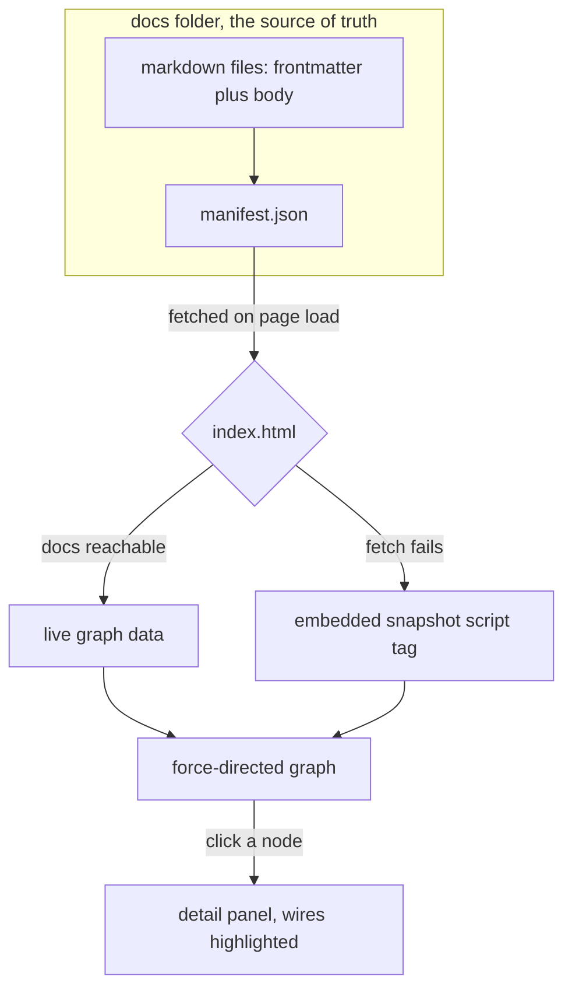
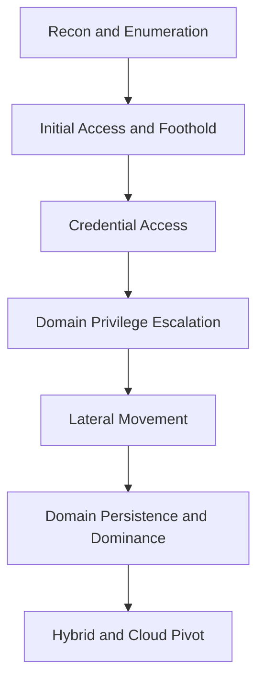

# FindMyAttackPath


An open-source, click-through map of the Active Directory attack chain — recon to domain
dominance to hybrid/cloud pivot — built for authorized red-team engagements, Active Directory
exploitation assessment practice, and job-role preparation. It is not defense-only: red-teamers
can use it to understand and assess attack paths, while detection and mitigation notes help
teams validate controls. Use it only within written authorization or an isolated lab.

Every phase, technique, tool and CVE on the graph is backed by a markdown file under
[`docs/`](docs/). Click a node and its connections ("wires") light up, and the detail panel
shows the prerequisite, the detection artifact a blue team would actually see, and the
tool(s) used to run it.

> Compiled for authorized testing and study (OSCP/CRTO-style prep). Reverify current patch
> status before relying on anything tagged "new."

## Deploy it

[](https://vercel.com/new/clone?repository-url=https://github.com/alham-rizvi/FindMyAttackPath)

When importing on Vercel: **Framework Preset → Other**, **Build Command → empty**, and set
**Root Directory** to wherever `index.html` and `docs/` live if they're not at the repo root.
No build step — it's a static page.

## Run it locally

```bash
git clone https://github.com/alham-rizvi/FindMyAttackPath.git
cd FindMyAttackPath
python3 -m http.server 8000
# open http://localhost:8000
```

`index.html` reads its data with `fetch()`, so it has to be served over http(s) — opening the
file directly (`file://`) will fail with a CORS error. Any static server works.

## How it's wired together



`index.html` never needs to change when someone adds an attack vector — add a markdown file,
list it in `docs/manifest.json`, open a PR. If you also want the single-file fallback to carry
your change (useful for hosts that only take one file), run `python3 scripts/embed-docs.py`
before deploying — see [`scripts/embed-docs.py`](scripts/embed-docs.py).

The resource index includes searchable tool and reference tabs plus recent project commits.
Use the lower-right toolbox to recolor the graph or download selected phases as JSON, CSV,
CSS, or SVG. Node detail panels can be expanded for wide tables and diagrams; Mermaid diagrams
also have a full-size viewer with SVG and source downloads.

## The kill chain the graph is built around



Each phase branches into the techniques that belong to it; each technique links to the
tool(s) that run it and, where one applies, the CVE it exploits.

## Project structure

```
index.html              the graph — fetches docs/, falls back to the embedded snapshot
vercel.json             pins this as a plain static deploy (no build step)
docs/
  manifest.json         index of every graph node file below
  README_START_HERE.md   authorized AD assessment study guide
  phases/*.md           the 7 kill-chain phases
  techniques/*.md       attack techniques, one file each
  tools/*.md            tool/repo metadata referenced by techniques
  cves/*.md             CVE-backed techniques
scripts/
  embed-docs.py         refreshes index.html's bundled fallback snapshot from docs/
CONTRIBUTING.md         file format + step-by-step guide for adding a new attack vector
```

## Starter study guide

For a guided, command-free route through authorized Active Directory red-team assessment topics, see [docs/README_START_HERE.md](docs/README_START_HERE.md).

## Contributing

This is open source — adding a new attack vector is a markdown file and a PR, not a code
change. See [CONTRIBUTING.md](CONTRIBUTING.md) for the exact frontmatter format for each node
type, how to embed a Mermaid diagram in a technique's writeup, and the PR checklist.
