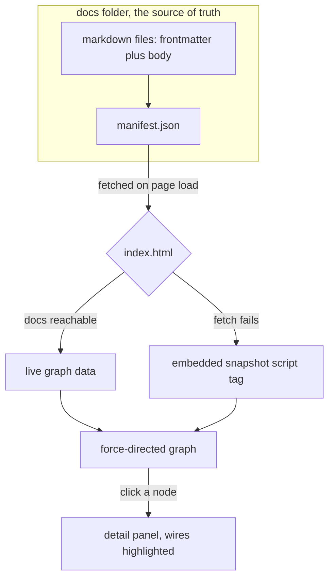
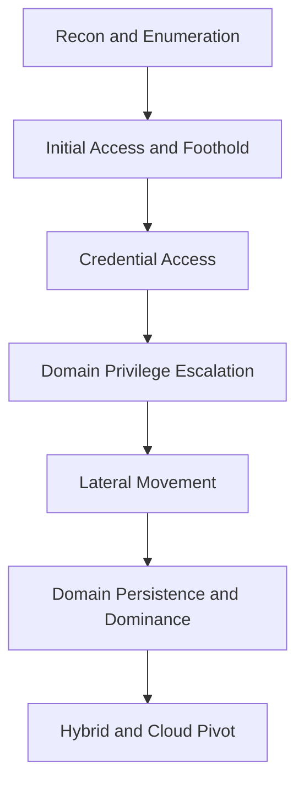

# FindMyAttackPath


An open-source, click-through map of the Active Directory attack chain: recon to domain
dominance to hybrid/cloud pivot, built for authorized red-team engagements, Active Directory
exploitation assessment practice, and job-role preparation. It is not defense-only: red-teamers
can use it to understand and assess attack paths, while detection and mitigation notes help
teams validate controls. Use it only within written authorization or an isolated lab.

Every phase, technique, tool and CVE on the graph is backed by a Markdown file under
[`docs/`](docs/). Click a node and its connections ("wires") light up. The detail panel shows
the available context, such as affected objects, potential impact, detection and defensive
measures, plus related tools where listed.

## Deploy it

[](https://vercel.com/new/clone?repository-url=https://github.com/alham-rizvi/FindMyAttackPath)

For Vercel, use **Framework Preset → Other**, leave **Build Command** blank, and set the output
directory to `.` (as specified in `vercel.json`). Keep **Root Directory** set to the project
directory containing `index.html`, `docs/` and `vercel.json`; in a monorepo, select that project
directory. No build step is required because this is a static site.

## Run it locally

```bash
git clone https://github.com/alham-rizvi/FindMyAttackPath.git
cd FindMyAttackPath
python3 -m http.server 8000
# open http://localhost:8000
```

`index.html` loads its data with `fetch()`, so serve it over HTTP(S). Browsers restrict fetches
from local `file://` URLs; use a local HTTP server instead. Any static server works.

## How it's wired together



The graph loads its documentation from `docs/manifest.json`, so adding a node does not require a
code change to `index.html`: add the Markdown file, list it in the manifest, and open a PR. To
refresh the embedded fallback in `index.html` as well (for single-file hosting), run
`python3 scripts/embed-docs.py` before deploying; see [`scripts/embed-docs.py`](scripts/embed-docs.py).

The resource index includes searchable tool and reference tabs plus recent project commits.
Use the lower-right toolbox to recolor node types or individual nodes, change canvas and
relationship connector colors, apply high-contrast or color-blind-friendly palettes, find shortest
paths, bookmark study items, add custom nodes, and download selected phases as JSON, CSV, CSS,
or SVG. Toolbox state and color choices are remembered in this browser. Node detail panels can
be expanded for wide tables and diagrams; Mermaid diagrams also have a full-size viewer with SVG
and source downloads.

## The kill chain the graph is built around



Each phase branches into its techniques. Techniques connect to related tools where listed and
to an associated CVE where applicable.

## Project structure

```
index.html              the graph — fetches docs/, falls back to the embedded snapshot
vercel.json             pins this as a plain static deploy (no build step)
docs/
  manifest.json         index of every graph node file below
  README_START_HERE.md   authorized AD assessment study guide
  phases/*.md           the 7 kill-chain phases
  techniques/*.md       attack techniques, one file each
  tools/*.md            tool/repo metadata referenced by techniques
  cves/*.md             CVE-backed techniques
scripts/
  embed-docs.py         refreshes index.html's bundled fallback snapshot from docs/
CONTRIBUTING.md         file format + step-by-step guide for adding a new attack vector
```

## Starter study guide

For a guided, command-free route through authorized Active Directory red-team assessment topics, see [docs/README_START_HERE.md](docs/README_START_HERE.md).

## Contributing

This is open source — adding a new attack vector is a markdown file and a PR, not a code
change. See [CONTRIBUTING.md](CONTRIBUTING.md) for the exact frontmatter format for each node
type, how to embed a Mermaid diagram in a technique's writeup, and the PR checklist.
