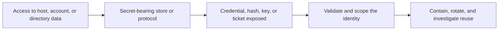

Obtain or recover authentication material that can be used to impersonate an identity or access another system. The material may be a password, password-derived hash, Kerberos ticket or key, DPAPI-protected secret, local account secret, directory database, or cloud synchronization credential. Possession of a hash or ticket is not the same as knowing a plaintext password, but it can still grant authentication capabilities.

## How this phase works

Credential exposure usually follows access to a place where secrets are stored or used: process memory, a registry hive, a backup or database, a user's profile, a service account, or an authentication exchange. Some techniques collect material for offline analysis; others require privileged access to a domain controller or endpoint. Password-derived material must be handled as a secret even when it is not directly readable.

Techniques represented here include LSASS, SAM / LSA and NTDS extraction, ticket collection, DPAPI, roasting, Timeroasting, and dMSA-related credential exposure.

## Defensive view

Reduce local administrator rights, enable Credential Guard and LSASS protections where compatible, protect domain-controller backups and database files, use managed service accounts, and prefer long randomly generated secrets. Monitor access to sensitive processes and stores, unexpected replication activity, and unusual Kerberos request patterns. After suspected exposure, revoke sessions where possible and rotate credentials in dependency-aware order; changing one password does not invalidate every ticket or derived secret.

## References

- [MITRE ATT&CK: Credential Access](https://attack.mitre.org/tactics/TA0006/)
- [MITRE ATT&CK: OS Credential Dumping](https://attack.mitre.org/techniques/T1003/)
- [Microsoft: Credential Guard overview](https://learn.microsoft.com/windows/security/identity-protection/credential-guard/)
