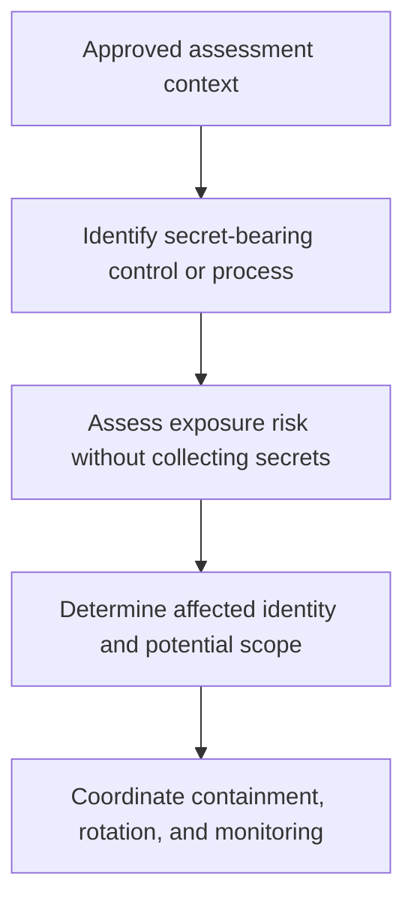

# Credential access: understand exposure and reduce its scope

Credential access concerns the exposure or recovery of material that can authenticate an identity or protect sensitive data. Examples include passwords, password-derived keys, Kerberos tickets, application secrets, certificates, and recovery material. These artifacts are not interchangeable: some are time- or service-limited, while others may permit authentication without revealing a readable password.

For authorized red-team assessment and job preparation, study where secrets may be stored or used, how exposure can affect connected systems, and how defenders can detect and contain it. Do not collect real credentials or secrets as proof. Prefer synthetic identities and isolated labs; when the engagement needs evidence, agree on a redacted, minimal, securely handled alternative with the owner.

## Conceptual model

Credential exposure often arises where authentication material is stored, processed, backed up, or transmitted. Risk depends on the material, the associated identity, its privileges, where it is accepted, and whether sessions or derived credentials remain valid.

Topics represented in this repository include [Kerberos service-account ticket exposure](../techniques/kerberoast.md), [accounts without Kerberos pre-authentication](../techniques/asreproast.md), [LSASS](../techniques/lsass_dump.md), [SAM and LSA stores](../techniques/sam_lsa.md), [DPAPI](../techniques/dpapi.md), [legacy Group Policy Preferences secrets](../techniques/gpp_cpassword.md), [directory database exposure](../techniques/ntds_dump.md), and [managed service accounts](../techniques/laps_gmsa.md). These links are conceptual study references, not authorization to extract or use secret material.

## Safe learning progression

1. **Classify the material.** Understand whether the concern is a password, derived key, ticket, certificate, protected user data, or broad directory secret store.
2. **Map its scope conceptually.** Identify which identity, services, systems, and trust relationships could depend on it without testing it against live systems.
3. **Assess exposure controls.** Review least privilege, secret storage, endpoint protections, service-account design, backup access, and monitoring with the system owner.
4. **Use a lab for demonstrations.** Practice only with synthetic accounts and deliberately vulnerable, isolated environments that cannot reach production.
5. **Report and remediate.** Describe the risk and evidence without disclosing secrets; coordinate credential/session containment with identity and service owners.

## Material and response considerations

| Material class | Potential concern | Response consideration |
| --- | --- | --- |
| Password or application secret | Reuse or access to dependent services | Rotate at the source, identify reuse and dependencies, and review sessions |
| Password-derived key | Authentication capability may exist without plaintext disclosure | Treat as sensitive; rotate the underlying secret and investigate relevant logons |
| Kerberos ticket | Authentication may be limited by identity, service, realm, and lifetime | Assess ticket use and related sessions; password change alone may not end existing sessions |
| Protected user data | Access may depend on profile, recovery, or key material | Protect both the data and its recovery keys; scope affected users carefully |
| Directory or backup data | Broad exposure of identities and credential material | Treat as potentially domain-wide; use a coordinated recovery plan |
| Certificate or synchronized cloud secret | May bridge on-premises, application, or cloud access | Include certificate revocation and cloud-session containment where applicable |

## Detection and remediation context

Reduce local administrator access, enable compatible protections for credential-bearing processes, protect domain-controller databases and backups, and replace unmanaged service secrets with approved managed identity patterns. Monitor access to sensitive processes and stores, unusual replication-related activity, and authentication patterns that diverge from known service behavior. Investigate the source identity and host alongside subsequent authentication events.

Containment is dependency-aware. A password reset may not invalidate an already issued ticket, certificate, application token, synchronized cloud credential, or active session. Preserve relevant evidence, identify the exposed material and its scope, coordinate rotation or revocation with service owners, and verify that the old access path is no longer trusted. Minimize retention of assessment evidence and follow the engagement's handling and deletion requirements.

## Learning objectives

Be able to distinguish credential-material classes, explain why exposure can outlast a password change, describe safe evidence handling, and outline a coordinated detection and recovery approach without collecting or replaying secrets.
