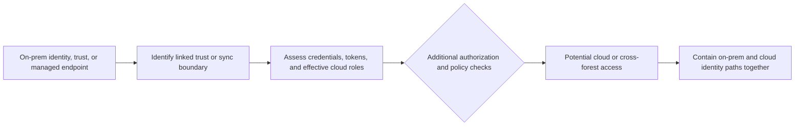

Follow an identity relationship beyond one domain: across a forest trust, from Active Directory to Microsoft Entra ID, or from a hybrid-joined endpoint into cloud services. A hybrid connection is not automatically a privilege bridge; the risk depends on sync configuration, token and device protections, tenant roles, and the direction and scope of trust.

## Typical progression

Relevant graph entries include trust-ticket abuse, Entra Connect credential exposure, Primary Refresh Token (PRT) abuse, and passkey-related authentication concerns. A PRT is a protected token associated with device and user state; a raw FIDO2/passkey assertion is challenge-bound and should not be described as a reusable password. Treat stolen sessions or tokens as bearer credentials, while distinguishing them from replaying a raw authenticator response.

## Defensive view

Inventory and restrict synchronization service identities, protect hybrid-joined endpoints, enforce phishing-resistant authentication and Conditional Access, monitor unusual token and sign-in patterns, and review cross-forest trust filtering. Cloud incident response should revoke sessions and refresh tokens as appropriate while also containing the on-prem source of compromise.

## References

- [MITRE ATT&CK: Cloud Accounts](https://attack.mitre.org/techniques/T1078/004/)
- [Microsoft: How Microsoft Entra Connect works](https://learn.microsoft.com/entra/identity/hybrid/connect/whatis-azure-ad-connect)
- [Microsoft: Primary Refresh Tokens](https://learn.microsoft.com/entra/identity/devices/concept-primary-refresh-token)
- [FIDO Alliance: Passkeys](https://fidoalliance.org/passkeys/)
