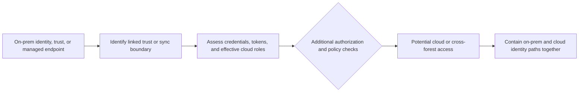

Follow an identity relationship beyond one domain: across a forest trust, from Active Directory to Microsoft Entra ID, or from a hybrid-joined endpoint into cloud services. A hybrid connection is not automatically a privilege bridge; the risk depends on sync configuration, token and device protections, tenant roles, and the direction and scope of trust.

## Typical progression



Relevant graph entries include trust-ticket abuse, Entra Connect credential exposure, Primary Refresh Token (PRT) abuse, and passkey-related authentication concerns. A PRT is a protected token associated with device and user state; a raw FIDO2/passkey assertion is challenge-bound and should not be described as a reusable password. Treat stolen sessions or tokens as bearer credentials, while distinguishing them from replaying a raw authenticator response.

## Defensive view

Inventory and restrict synchronization service identities, protect hybrid-joined endpoints, enforce phishing-resistant authentication and Conditional Access, monitor unusual token and sign-in patterns, and review cross-forest trust filtering. Cloud incident response should revoke sessions and refresh tokens as appropriate while also containing the on-prem source of compromise.

## Objects and defensive configuration

```text
Object: Directory synchronization identity and connector configuration
Risky state: Excessive on-prem/cloud privileges, unmanaged credentials, or unknown sync scope
Defensive target: Least privilege, protected secret storage, and documented object/attribute scope
Fix: Reduce rights through the supported deployment process and rotate exposed credentials

Object: Hybrid-joined endpoint, PRT/session, and authentication policy
Risky state: Unmanaged device or token/session outside expected user and device context
Defensive target: Device compliance, phishing-resistant authentication, and Conditional Access
Fix: Contain the endpoint and revoke affected sessions using tenant recovery procedures

Object: Forest trust, app registration, service principal, and tenant role assignment
Risky state: Excessive trust scope, application permission, or privileged role assignment
Defensive target: Explicit business owner, minimal scope, and audited changes
Fix: Remove unneeded authorization and validate both on-premises and cloud dependencies
```

## References

- [MITRE ATT&CK: Cloud Accounts](https://attack.mitre.org/techniques/T1078/004/)
- [Microsoft: How Microsoft Entra Connect works](https://learn.microsoft.com/entra/identity/hybrid/connect/whatis-azure-ad-connect)
- [Microsoft: Primary Refresh Tokens](https://learn.microsoft.com/entra/identity/devices/concept-primary-refresh-token)
- [FIDO Alliance: Passkeys](https://fidoalliance.org/passkeys/)

## Boundaries to assess

| Boundary | Relevant questions |
| --- | --- |
| Forest or domain trust | Which identities can authenticate across it? Are filtering and selective authentication configured as intended? |
| Directory synchronization | Which objects and attributes are synchronized, and what roles does the sync identity hold in each environment? |
| Device registration | Is the endpoint managed, compliant, and bound to the identity that is signing in? |
| Session and token | What is the artifact's scope and lifetime, and can it be revoked centrally? |
| Cloud authorization | Which tenant roles, application permissions, and Conditional Access policies apply? |

## Coordinated response

Treat an on-premises and cloud incident as one identity incident when the environments share credentials, devices, synchronization, or trust. Preserve relevant sign-in and audit logs, contain the compromised endpoint and sync identity, revoke sessions where appropriate, and review both directory and tenant role changes. Password rotation alone may not revoke an active session or repair a compromised device.

Use the tenant's documented recovery process and involve both AD and cloud administrators. After containment, verify device registration, synchronization health, authentication methods, recovery contacts, application credentials, and cross-forest trust settings before returning the identity to normal use.
