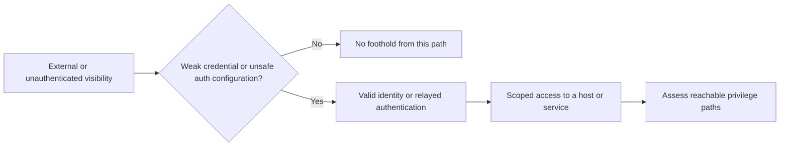

Obtain the first usable identity or execution foothold in the environment. This may involve a weak or reused password, an account configured without Kerberos pre-authentication, a service account with a guessable password, or an authentication design that permits relay. These are distinct conditions with different prerequisites; they should not be treated as interchangeable.

## What changes in this phase

The important transition is from observation to an authenticated identity, session, or trusted credential artifact. That initial access may be low privilege. Its risk depends on the identity's reachable systems, group memberships, and delegated rights—not simply on whether a login succeeded.

## Typical progression

Related techniques in this graph include password spraying, AS-REP roasting, Kerberoasting, coerced authentication and relay, NTLM reflection, and the linked AD CS relay variants. A technique's name does not imply a universal exploit: for example, relay depends on protocol protections and target configuration.

## Defensive view

Require strong, unique credentials and modern authentication protections; disable unnecessary NTLM and enforce signing / channel binding / Extended Protection where supported. Audit Kerberos pre-authentication settings and service-account password hygiene. Use rate-aware identity protection and correlate authentication failures across many accounts with subsequent successful logons. Changes to live authentication controls should be tested for compatibility.

## References

- [MITRE ATT&CK: Initial Access](https://attack.mitre.org/tactics/TA0001/)
- [MITRE ATT&CK: Valid Accounts](https://attack.mitre.org/techniques/T1078/)
- [Microsoft: Security guidance for NTLM](https://learn.microsoft.com/windows-server/security/kerberos/ntlm-overview)
