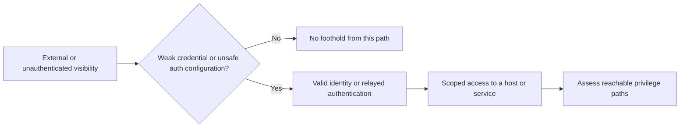

Obtain the first usable identity or execution foothold in the environment. This may involve a weak or reused password, an account configured without Kerberos pre-authentication, a service account with a guessable password, or an authentication design that permits relay. These are distinct conditions with different prerequisites; they should not be treated as interchangeable.

## What changes in this phase

The important transition is from observation to an authenticated identity, session, or trusted credential artifact. That initial access may be low privilege. Its risk depends on the identity's reachable systems, group memberships, and delegated rights—not simply on whether a login succeeded.

## Typical progression

Related techniques in this graph include password spraying, AS-REP roasting, Kerberoasting, coerced authentication and relay, NTLM reflection, and the linked AD CS relay variants. A technique's name does not imply a universal exploit: for example, relay depends on protocol protections and target configuration.

## Defensive view

Require strong, unique credentials and modern authentication protections; disable unnecessary NTLM and enforce signing / channel binding / Extended Protection where supported. Audit Kerberos pre-authentication settings and service-account password hygiene. Use rate-aware identity protection and correlate authentication failures across many accounts with subsequent successful logons. Changes to live authentication controls should be tested for compatibility.

## References

- [MITRE ATT&CK: Initial Access](https://attack.mitre.org/tactics/TA0001/)
- [MITRE ATT&CK: Valid Accounts](https://attack.mitre.org/techniques/T1078/)
- [Microsoft: Security guidance for NTLM](https://learn.microsoft.com/windows-server/security/kerberos/ntlm-overview)

## Practice labs

- [TryHackMe: Attacktive Directory](https://tryhackme.com/room/attacktivedirectory) is a guided, isolated introduction to common AD assessment concepts.
- [Hack The Box: Forest](https://app.hackthebox.com/machines/Forest) is a retired Windows/AD machine for practicing foundational domain assessment in a platform-provided lab.

## Common entry conditions

| Entry condition | What it means | Important limitation |
| --- | --- | --- |
| Weak or reused credential | A real account secret is accepted by an authentication service | Successful authentication grants only that account's configured rights |
| Kerberos account setting | A response is available for an account with an unsafe authentication setting | Offline password guessing succeeds only if the secret is recoverable |
| Relayable authentication | An authentication exchange can be reused by an inadequately protected service | A trigger, network path, and vulnerable destination must all align |
| Vulnerable software | A specific product/build has a security flaw | Exposure depends on version, patch state, configuration, and vendor-defined prerequisites |

## Validate the foothold safely

Define what counts as success before testing: for example, confirmation that an approved test identity authenticates to a designated lab service. Do not equate failed logons with proof that no risk exists, or a successful low-privilege logon with administrative compromise. Use designated test accounts, agreed rate and lockout limits, and a rollback contact for any authentication test. Preserve timestamps and source-host context so the blue team can correlate the event.

## Evidence to retain

Record the account or service involved, the affected setting or patch level, the source and destination, the observed result, and whether state changed. Do not retain reusable passwords, hashes, tickets, or tokens in ordinary reports. If a credential is exposed in an authorized test, handle it as a secret and coordinate rotation with the owner.
