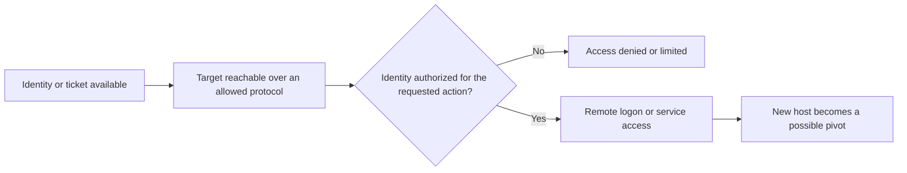

Use an identity or authentication artifact from one system to access another. Common mechanisms include remote management protocols, interactive remote sessions, or reusing an NTLM hash or Kerberos ticket. The target's authorization and network controls determine what the identity can do; successful authentication does not necessarily mean remote execution is possible.

## Typical progression

Pass-the-hash, pass-the-ticket, overpass-the-hash, WMI / WinRM / SMB, RDP, and WMI event subscriptions represent different behaviors and leave different evidence. Treat fileless execution as a persistence or execution concern as well as a movement concern.

## Defensive view

Segment administrative tiers, restrict remote-management paths, use Windows Defender Firewall and just-in-time administration, and prevent privileged accounts from signing in to lower-trust hosts. Correlate logon type, source device, account, destination, and process / service creation. Use unique local administrator passwords and review cached or disconnected sessions on shared systems.

## References

- [MITRE ATT&CK: Lateral Movement](https://attack.mitre.org/tactics/TA0008/)
- [MITRE ATT&CK: Remote Services](https://attack.mitre.org/techniques/T1021/)
- [Microsoft: Windows LAPS overview](https://learn.microsoft.com/windows-server/identity/laps/laps-overview)

## The identity and the transport are separate

| Access material or method | What it establishes | What it does not establish |
| --- | --- | --- |
| Password-derived hash | An authentication method accepted by some NTLM services | Plaintext knowledge or authorization on every host |
| Kerberos ticket | A ticket for a particular identity and service or realm | Universal access or a new privilege level |
| Remote-management protocol | A channel to a configured service | Permission to perform every action through that service |
| Interactive remote session | A user session on a destination host | Authorization to take over another user's session |

Assess the account, host, protocol, and requested action together. For example, an account can authenticate successfully but be denied remote administration, or be allowed to connect to a service that exposes no sensitive operation. Keep tests limited to named hosts and approved accounts, and avoid broad discovery or execution loops.

## Correlation for defenders

Build a timeline linking source logon, destination logon, protocol, process or service activity, and any later authentication from the destination. Compare the source device and account with normal administrative workflows. Alert on privileged identities accessing lower-trust endpoints, unusual host-to-host fan-out, and remote execution outside approved management windows.
