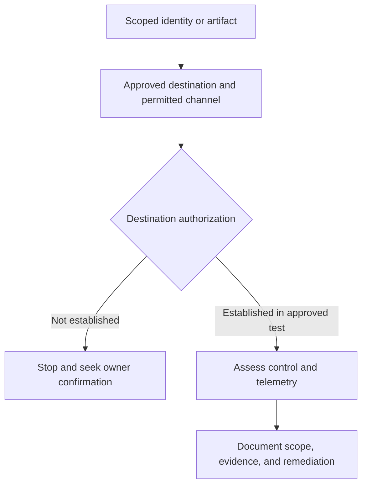

# Lateral movement: assess identity, host, and access boundaries

Lateral movement describes the use of an identity or authentication artifact in a context different from its original one, commonly across systems in the same environment. Passwords, password-derived keys, and Kerberos tickets have different properties, and remote-management services impose their own authorization checks. Authentication on a destination does not automatically grant administrative access or the ability to perform a sensitive action.

In an authorized assessment, study how identity reuse, session placement, network segmentation, and remote-management policy combine to shape risk. Keep the work to named systems and approved test identities. Do not perform broad discovery, credential replay, remote execution, or access checks against unapproved hosts.

## Conceptual progression

This phase includes conceptual study of [pass-the-hash](../techniques/pth.md), [pass-the-ticket](../techniques/ptt.md), [overpass-the-hash](../techniques/opth.md), [WMI access](../techniques/wmi_exec.md), [RDP](../techniques/rdp_lateral.md), and [relay risks](../techniques/coerce_relay.md). These topics are not instructions to replay authentication material or execute actions remotely.

## Safe assessment sequence

First confirm the exact account, host, protocol, and action in scope. Review the owner's intended administrative paths and the destination's authorization policy. Evaluate exposure through configuration and documented evidence before proposing any live validation. If the test could create a session, execute code, alter data, or affect availability, require explicit written authorization and a coordinated test window. Prefer a synthetic account and isolated lab for practical demonstrations.

Document the distinction between identity and transport: an artifact may enable a specific authentication flow, while the protocol may permit only a narrow function. Record observed controls, uncertainties, and whether the conclusion is theoretical or confirmed under an approved test. Never infer permission on every host from a successful authentication elsewhere.

## Defensive view

Segment administrative tiers and limit remote-management routes to approved source systems and identities. Use just-in-time administration where appropriate, avoid privileged logons to lower-trust endpoints, maintain unique managed local administrator credentials, and reduce unnecessary cached or disconnected sessions. Apply host firewall and protocol protections in a way that preserves approved management workflows.

Correlate source and destination logons with account, logon type, endpoint, protocol, and subsequent process or service activity. Investigate unexpected host-to-host fan-out, privileged identities on lower-trust systems, and remote access outside known administrative patterns. During an incident, contain affected endpoints and sessions while preserving evidence and coordinating identity recovery.

## Learning objectives

Be able to explain why authentication and authorization are separate, identify the controls that govern cross-host access, describe useful defender telemetry, and propose safe evidence collection and segmentation improvements without carrying out unapproved movement.
