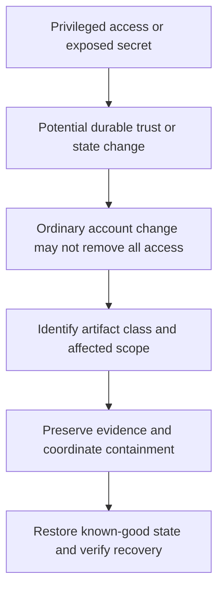

# Persistence: understand durable access and recovery

Persistence is the retention of access after an initial account, session, or foothold is removed. In an Active Directory environment, durability can come from altered directory state, exposed signing or authentication keys, certificates, trust relationships, active sessions, or changes on a host. The consequences range from a single service to a forest-wide recovery problem.

This is a high-impact topic. For red-team learning, focus on recognizing artifact classes, explaining why routine password changes may be insufficient, and evaluating detection and recovery controls. Do not create persistence in production or follow execution recipes. Practical demonstrations belong in an isolated lab with synthetic identities and explicit authorization.

## Conceptual lifecycle

Topics represented in this repository include [replication-right exposure](../techniques/dcsync.md), [Kerberos ticket abuse](../techniques/golden.md), [service-ticket forgery concepts](../techniques/silver.md), [certificate trust risks](../techniques/golden_cert.md), [directory replication change scenarios](../techniques/dcshadow.md), [SID history](../techniques/sidhistory.md), [protected-object permissions](../techniques/adminsdholder.md), and [cross-trust ticket risks](../techniques/trust_ticket.md). These references support conceptual study, not instructions for establishing persistence.

## Artifact classes and recovery focus

| Artifact class | Examples | Recovery focus |
| --- | --- | --- |
| Directory state | Privileged membership, ACLs, SID history, delegation, directory registrations | Compare against approved baselines and audit records; restore verified state |
| Authentication keys | Domain, service, certificate-authority, or trust secrets | Protect evidence and follow dependency-aware vendor recovery guidance |
| Issued credentials | Certificates, tickets, cloud sessions | Revoke or expire affected artifacts and investigate relying systems |
| Host state | Authentication components, services, subscriptions, or policy effects | Preserve evidence; determine whether trusted rebuild or restoration is required |

## Detection and remediation context

Protect and monitor replication permissions, domain-controller configuration, certificate-authority private keys, privileged groups, trust settings, and administrative host state. Maintain secure backups, known-good configuration baselines, and a tested forest recovery plan. Investigate unexpected privileged directory changes, certificate issuance, replication-related activity, or unusual authentication patterns using correlated identity, host, and service evidence.

Recovery is broader than resetting one account. First contain affected identities and systems while preserving forensic evidence. Identify all potentially affected artifact classes and coordinate with identity, PKI, cloud, and service owners. Remove only confirmed unauthorized changes; careless alteration of replication, certificate, or policy configuration can disrupt legitimate operations. Rotate or revoke affected material according to a tested, dependency-aware recovery plan, then verify that old trust paths are no longer accepted and continue monitoring for recurrence.

For suspected domain-wide key exposure, follow current Microsoft forest-recovery and key-reset guidance through the responsible administrators. Record what was rotated, where changes were applied, what dependencies were validated, and what evidence supports recovery. A single password change does not establish that existing tickets, certificates, sessions, cloud tokens, or host changes are gone.

## Safe learning progression

Use fictional scenarios to compare the durability and blast radius of directory-state changes, keys, issued credentials, and host-level artifacts. In a lab, focus on defender-side baselines, audit signals, and recovery validation rather than creating real-world persistence. In a job interview, explain the recovery dependencies and why evidence preservation and coordination matter before making changes.

## Learning objectives

Be able to classify persistence artifacts, describe how they can survive ordinary credential changes, outline a safe investigation and coordinated recovery, and recommend controls that protect Tier-0 identities and trust material—without establishing persistence on live systems.
