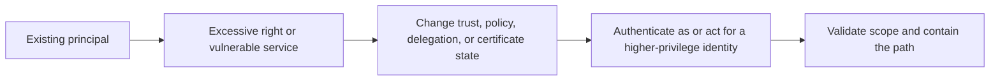

Move from an existing identity to greater control by taking advantage of excessive permissions, unsafe delegation, certificate-service misconfiguration, or an unpatched vulnerability. The path is often a chain: one right permits changing an object, the changed object enables another authentication flow, and that flow grants access to a more privileged identity.

## How to reason about a path

Assess the effective permissions and configuration, not just group names. A finding is meaningful only when the current principal can reach the vulnerable object or service, the affected setting is active, and the resulting identity has privileges that matter. Misconfiguration-based paths and CVE-based paths have different remediation: least privilege and configuration correction versus patching, with defense-in-depth for both.



The graph includes ACL and GPO abuse, DNSAdmins, machine-account creation, delegation variants, Shadow Credentials, AD CS ESC1–ESC16, and named vulnerabilities such as noPac and ResetNightmare.

## Defensive view

Continuously review effective ACLs on privileged users, groups, computers, GPOs, and certificate templates. Minimize who can enroll in authentication-capable templates, remove unnecessary delegation, restrict machine-account creation where operationally appropriate, and patch supported systems. Alert on privilege-bearing directory changes and certificate issuance, and verify remediation by re-evaluating the complete path rather than just the original finding.

## Objects and defensive configuration

```text
Object: Privileged user/group, computer, GPO, CA, or certificate template
Risky state: Unintended write/owner/enrollment rights or broadly delegated control
Defensive target: Effective ACLs match a documented least-privilege owner and workflow
Fix: Remove excess rights, review inheritance/nested groups, and verify after replication

Object: Delegation and computer-account configuration
Risky state: Unneeded delegation or broad ability to create/change computer identities
Defensive target: Only documented services and roles retain the required settings
Fix: Remove unused delegation; review machine-account creation policy with service owners

Object: CA policy, enrollment endpoint, and issued-certificate mapping
Risky state: Weak identity binding, excessive enrollment, or unnecessary endpoint exposure
Defensive target: Directory-derived identity, restricted enrollment, strong mapping, protected CA
Fix: Correct the earliest shared control and validate the full path in an isolated lab
```

## References

- [MITRE ATT&CK: Privilege Escalation](https://attack.mitre.org/tactics/TA0004/)
- [Microsoft: Active Directory Certificate Services overview](https://learn.microsoft.com/windows-server/identity/ad-cs/active-directory-certificate-services-overview)
- [SpecterOps: Certified Pre-Owned](https://specterops.io/wp-content/uploads/sites/3/2022/06/Certified_Pre-Owned.pdf)

## Practice labs

- [Hack The Box: Certified](https://app.hackthebox.com/machines/Certified) is a retired AD certificate-services lab for selected template and certificate-mapping concepts; it is not a complete ESC taxonomy exercise.
- [TryHackMe: Attacktive Directory](https://tryhackme.com/room/attacktivedirectory) offers a guided AD foundation before studying multi-step privilege paths.

## Validate every edge

| Check | Question |
| --- | --- |
| Starting identity | Which exact principal and current session are in scope? |
| Effective permission | Does that principal have the required right after inheritance and nested-group membership are resolved? |
| Target state | Is the affected ACL, policy, delegation setting, template, or software version actually present? |
| Reachability | Can the approved test system reach the target service under the rules of engagement? |
| Resulting authority | What identity or action would the path provide, and what can that identity actually access? |
| Operational safety | Could validation alter directory state, issue a credential, disrupt a service, or affect users? |

## Findings versus confirmed impact

Report the complete prerequisite chain and the evidence for each link. A static graph or template scanner may over-approximate reachable paths because it cannot always account for current group membership, CA policy, network restrictions, or service-side authorization. Use a non-destructive validation where possible; any state-changing proof should be explicitly approved, isolated, reversible, and coordinated with the system owner.

Prioritize repairs at the earliest shared control in multiple paths: overly broad object write rights, weak enrollment policy, unnecessary delegation, unpatched domain controllers, or excessive administrative access. After remediation, recalculate the path and confirm dependent services still function.
