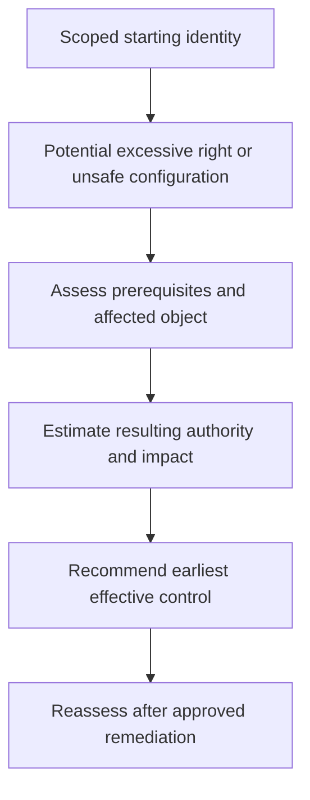

# Privilege escalation: reason about effective control paths

In Active Directory, privilege escalation is a change in the level of authority available to an identity. A path may involve excessive permissions, unsafe delegation, certificate-service configuration, group policy, or a vulnerable system. Often several conditions combine: one permission influences an object or service, which then affects authentication or access elsewhere.

The purpose of an authorized assessment is to establish whether a plausible path exists and what control would break it—not to exercise that path against a live environment by default. A directory graph, scanner result, or vulnerability label is a hypothesis until its prerequisites and scope are established. Prefer non-invasive review and owner confirmation; state-changing validation requires explicit authorization, isolation, reversibility, and coordination.

## Reason about a path

For each proposed edge, ask: Which exact principal is in scope? What effective right applies after inheritance and group nesting? Is the configuration actually present and active? What authority would result, and on which resources? Could validation change state, issue a credential, or affect service availability? Record what is observed separately from what is inferred.

Topics in this phase include [ACL relationships](../techniques/acl_abuse.md), [GPO permissions](../techniques/gpo_abuse.md), [delegation](../techniques/constrained_deleg.md) and [resource-based delegation](../techniques/rbcd.md), [machine-account policy](../techniques/machineaccountquota.md), [Shadow Credentials](../techniques/shadow_creds.md), [AD CS configuration](../techniques/adcs_enum.md), and named vulnerability case studies such as [noPac](../techniques/nopac.md) and [ResetNightmare](../techniques/resetnightmare.md). These are learning references; no exploitation steps are provided here.

## Safe progression for assessment and job preparation

Start by understanding the identity and assets explicitly included in the engagement. Review approved architecture, access-control, policy, and patch evidence. Form a specific hypothesis and identify the minimum evidence needed to evaluate it. If confirming a condition requires changing directory state, requesting a certificate, altering a policy, or interacting with a sensitive service, stop and obtain written approval for a controlled lab or owner-supervised test. Report prerequisites, uncertainty, potential impact, and a clear remediation path.

For interview and lab preparation, build a conceptual chain using fictional objects: explain how a delegated permission could affect a sensitive group, or how an enrollment policy could change identity assurance. Demonstrate reasoning and mitigation in an isolated lab with synthetic identities rather than reproducing a live-target procedure.

## Defensive review and remediation

Regularly review effective permissions on privileged users, groups, computers, policies, and certificate templates. Ensure each right has a documented owner and business purpose. Restrict enrollment and identity mapping to intended workflows, remove unnecessary delegation, review machine-account creation policy with service owners, and maintain supported patch levels.

Monitor privilege-bearing directory changes, sensitive certificate issuance, replication-related permissions, and unexpected policy updates. Remediate shared root causes where possible: a single excessive right or overly broad enrollment rule may create several apparent paths. Verify the complete hypothesis is no longer valid after approved changes, while checking that legitimate services continue to operate.

## Findings versus confirmed impact

A static relationship graph may overstate reachability because it cannot always account for current membership, service-side checks, network boundaries, or operational controls. Report evidence for every prerequisite and distinguish potential impact from observed impact. Avoid claiming domain-level compromise solely from a theoretical path. Where a non-destructive validation is unavailable, say so and provide the owner with the evidence needed to decide on a controlled test.

## Learning objectives

Be able to explain effective permissions, describe how configuration weaknesses compose into a path, evaluate uncertainty and operational risk, and prioritize remediation at the earliest shared control—without attempting unapproved changes or exploitation.
