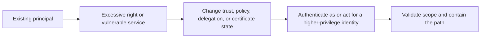

Move from an existing identity to greater control by taking advantage of excessive permissions, unsafe delegation, certificate-service misconfiguration, or an unpatched vulnerability. The path is often a chain: one right permits changing an object, the changed object enables another authentication flow, and that flow grants access to a more privileged identity.

## How to reason about a path

Assess the effective permissions and configuration, not just group names. A finding is meaningful only when the current principal can reach the vulnerable object or service, the affected setting is active, and the resulting identity has privileges that matter. Misconfiguration-based paths and CVE-based paths have different remediation: least privilege and configuration correction versus patching, with defense-in-depth for both.

The graph includes ACL and GPO abuse, machine-account creation, delegation variants, Shadow Credentials, AD CS ESC1 / ESC8, and named vulnerabilities such as noPac and ResetNightmare.

## Defensive view

Continuously review effective ACLs on privileged users, groups, computers, GPOs, and certificate templates. Minimize who can enroll in authentication-capable templates, remove unnecessary delegation, restrict machine-account creation where operationally appropriate, and patch supported systems. Alert on privilege-bearing directory changes and certificate issuance, and verify remediation by re-evaluating the complete path rather than just the original finding.

## References

- [MITRE ATT&CK: Privilege Escalation](https://attack.mitre.org/tactics/TA0004/)
- [Microsoft: Active Directory Certificate Services overview](https://learn.microsoft.com/windows-server/identity/ad-cs/active-directory-certificate-services-overview)
- [SpecterOps: Certified Pre-Owned](https://specterops.io/wp-content/uploads/sites/3/2022/06/Certified_Pre-Owned.pdf)
