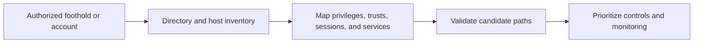

Build a picture of the directory and its relationships before attempting to change state. Reconnaissance can use ordinary directory reads to identify users, computers, groups, trust boundaries, delegated rights, logged-on sessions, shares, and certificate services. Much of this information is intentionally visible to authenticated users, so a successful query is not by itself evidence of compromise.

## What this phase answers

- Which accounts and systems exist, and which are likely to be privileged?
- Where are sensitive sessions, data shares, certificate authorities, and managed service accounts?
- Which object permissions or trust relationships create paths to higher privilege?

## Typical progression

In this repository, LDAP / ADSI enumeration, BloodHound collection, session and share reconnaissance, LAPS / gMSA discovery, AD CS enumeration, and trust mapping all belong here. The output is a set of hypotheses for later phases, not proof that a path is exploitable.

## Defensive view

Establish baselines for directory-query volume and source hosts; restrict sensitive attributes and administrative shares to roles that need them; review ACLs and certificate-template enrollment rights regularly. Correlate unusual directory access with the querying identity, endpoint, and subsequent authentication events. Keep collection authorized and scoped: broad inventory can expose personal or operationally sensitive information.

## References

- [MITRE ATT&CK: Account Discovery](https://attack.mitre.org/techniques/T1087/)
- [MITRE ATT&CK: Permission Groups Discovery](https://attack.mitre.org/techniques/T1069/)
- [Microsoft: Active Directory Domain Services overview](https://learn.microsoft.com/windows-server/identity/ad-ds/get-started/virtual-dc/active-directory-domain-services-overview)
