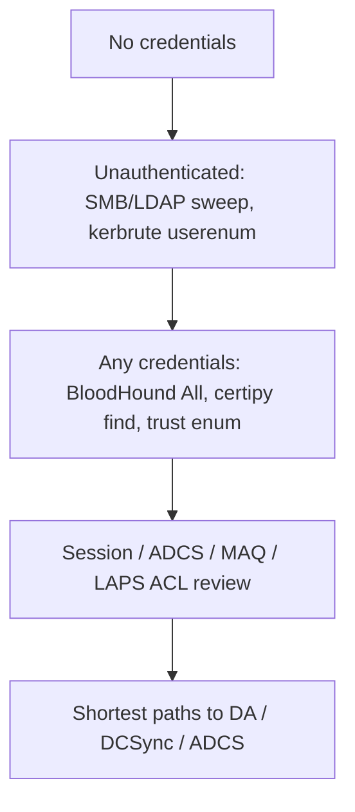

# Reconnaissance & Enumeration

### Objective
Build a complete graph of the domain **before touching anything**. The output is an owned-principal list and ranked attack paths.

### Affected objects (what you are enumerating)
Users, computers, groups, OUs, GPOs, trusts, ADCS templates, ACLs, sessions, LAPS/gMSA attributes, and **`ms-DS-MachineAccountQuota`**.

### Step-by-step workflow


### Exhaustive commands
```bash
