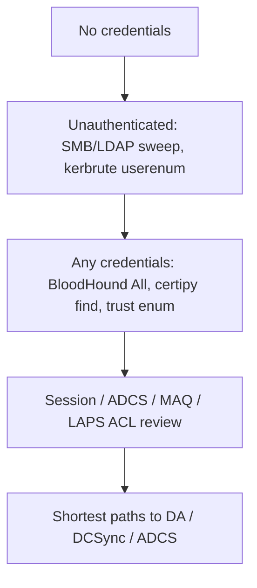

# Reconnaissance & Enumeration

### Objective
Build a complete graph of the domain **before touching anything**. The output is an owned-principal list and ranked attack paths.

### Affected objects (what you are enumerating)
Users, computers, groups, OUs, GPOs, trusts, ADCS templates, ACLs, sessions, LAPS/gMSA attributes, and **`ms-DS-MachineAccountQuota`**.

### Step-by-step workflow


### Exhaustive commands
```bash
# ── Unauthenticated SMB / LDAP sweep ─────────────────────────────────
nxc smb 10.10.10.0/24
nxc ldap 10.10.10.5 -u '' -p '' --users 2>/dev/null

# ── Username enumeration (Kerberos, no 4625) ─────────────────────────
kerbrute userenum -d corp.local users.txt --dc 10.10.10.5

# ── BloodHound collection (All) ───────────────────────────────────────
bloodhound-python -d corp.local -u lowpriv -p 'Password123!' \
  -c All -dc dc01.corp.local -ns 10.10.10.5
SharpHound.exe -c All --outputdirectory C:\temp --zipfilename bh.zip

# ── ADCS enumeration ──────────────────────────────────────────────────
certipy find -u lowpriv@corp.local -p 'Password123!' \
  -dc-ip 10.10.10.5 -enabled -vulnerable -text -stdout

# ── Trust enumeration ─────────────────────────────────────────────────
nltest /domain_trusts /all_trusts /v
Get-DomainTrust -Domain corp.local
nxc ldap 10.10.10.5 -u lowpriv -p 'Password123!' --trusted-for-delegation

# ── MAQ check ─────────────────────────────────────────────────────────
nxc ldap 10.10.10.5 -u lowpriv -p 'Password123!' -M maq

# ── Session recon ─────────────────────────────────────────────────────
nxc smb 10.10.10.0/24 -u lowpriv -p 'Password123!' --sessions
nxc smb 10.10.10.0/24 -u lowpriv -p 'Password123!' --loggedon-users

# ── LAPS ACL review ───────────────────────────────────────────────────
nxc ldap dc.corp.local -u lowpriv -p 'Password123!' -M laps
Get-DomainObjectAcl -LDAPFilter '(ms-mcs-AdmPwdExpirationTime=*)' -ResolveGUIDs
```

### Exit criteria
An owned-principal set and at least one ranked path: **DCSync rights**, **ADCS ESC**, **delegation**, or an **ACL edge**.

### Detection (what your recon trips)
LDAP query volume, SAMR enumeration, BloodHound user-agent strings, and 4662 mass object reads.

---
