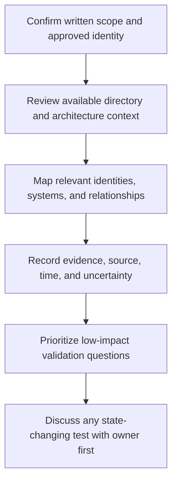

# Reconnaissance: build an evidence-based directory map

Reconnaissance is the disciplined collection and interpretation of information about an Active Directory environment. For an authorized assessment, its purpose is to understand identity, systems, trust boundaries, and effective permissions well enough to form testable security hypotheses—not to maximize data collection or assume that every apparent path can be used.

Directory information that is visible to an ordinary authenticated user may be expected behavior. A finding depends on context: what the assessed identity can actually access, whether the configuration is active, and what impact follows. Keep observed facts distinct from hypotheses, and avoid collecting personal or sensitive information that is not needed to answer the engagement question.

## What this phase answers

- Which users, service identities, groups, computers, and organizational units are relevant to the authorized scope?
- How do group nesting, object permissions, policies, trusts, and delegated administration shape effective access?
- Which services, certificate infrastructure, managed accounts, or sessions warrant closer defensive review?
- What evidence supports each hypothesis, and which questions require owner confirmation?

## Safe progression

Begin with scope, system-owner guidance, and existing documentation. Use approved read-only assessment methods and named identities. Limit observations to the agreed environment and question; do not perform broad target discovery, credential guessing, or changes to directory state. If a hypothesis would require sensitive access or a state-changing action to verify, stop at the evidence already available and obtain explicit approval and a safe test plan.

This phase connects to [LDAP enumeration](../techniques/ldap_enum.md), [BloodHound collection](../techniques/bloodhound_collect.md), [session reconnaissance](../techniques/session_recon.md), [trust enumeration](../techniques/trust_enum.md), and [LAPS / gMSA discovery](../techniques/laps_gmsa.md). Those references describe topics for controlled study; this phase does not prescribe operational collection steps.

## What to map

| Area | Examples of relevant evidence | Assessment question |
| --- | --- | --- |
| Identity | Users, service identities, groups, account state | Are responsibilities and privilege assignments justified? |
| Systems | Computer roles, operating-system support status | Are sensitive systems separated and maintained? |
| Authorization | Nested groups, ACLs, delegated rights, policy links | Can a principal influence a more sensitive object than intended? |
| Authentication services | Service identities, certificate templates, trust configuration | Are authentication paths narrowly configured and owned? |
| Runtime context | Approved observations about sessions, shares, and remote services | Are privileged identities exposed to lower-trust systems or data? |

## Interpret findings carefully

A graph edge, published service, or permissive-looking access-control entry is a lead, not proof of exploitable impact. Effective permissions may depend on inheritance, nested groups, service-side policy, reachability, and the exact principal in use. Record the evidence source, collection time, identity context, relevant configuration, and any assumptions. State clearly what remains unverified.

Prioritize questions by affected asset sensitivity, effective access, number of prerequisites, and potential operational impact. Prefer read-only confirmation. Ask the owner before any test that could alter policy, expose secrets, affect availability, or trigger account controls.

## Detection and remediation context

Establish baselines for directory-query patterns and authorized collection hosts. Review access to sensitive attributes, administrative shares, certificate enrollment, and delegated object rights. Correlate unusual directory access with identity, endpoint, and subsequent authentication activity. Remediation commonly includes reducing excess permissions, documenting administrative ownership, tightening enrollment and delegation policy, and validating changes against operational requirements.

## Learning objectives

A learner should be able to explain the difference between an observation and an attack-path hypothesis, describe how effective permissions and trust boundaries affect risk, document uncertainty and scope, and recommend proportionate controls without attempting unapproved validation.
