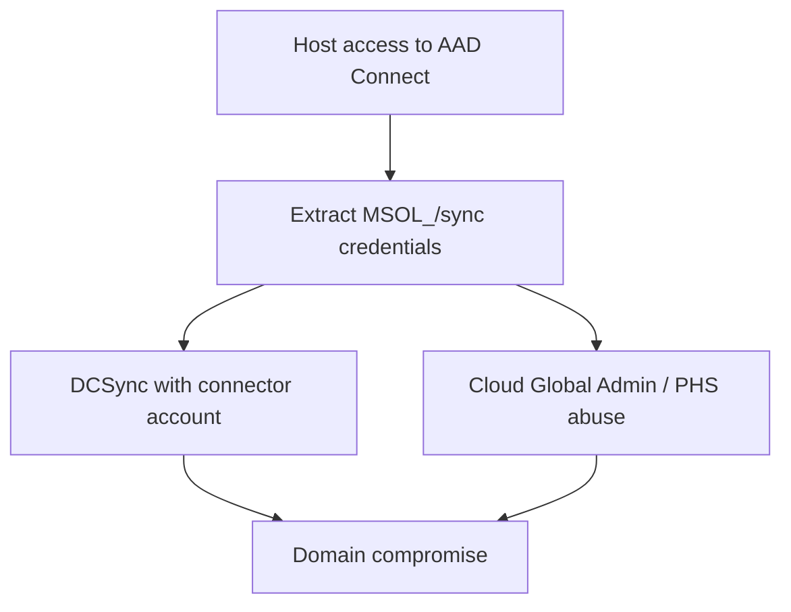

# Entra Connect credential extraction

### Affected object / attribute
**AAD Connect connector account** (`MSOL_*`) with **replication rights** on the domain, and the **on-prem sync credentials** stored encrypted in the AAD Connect SQL/LocalDB.

### Concept (deep)
Azure AD Connect needs to read and replicate directory data to synchronise it to Entra ID. The connector account is therefore effectively **DCSync-capable** by design. The host also stores the **on-premises sync account** and cloud credentials encrypted. Compromising the AAD Connect host yields both **domain replication** and a **cloud persistence path** (especially with Password Hash Sync, where resetting an on-prem password also resets the cloud password).

### Attack flow (Mermaid)


### Exhaustive commands
```bash
