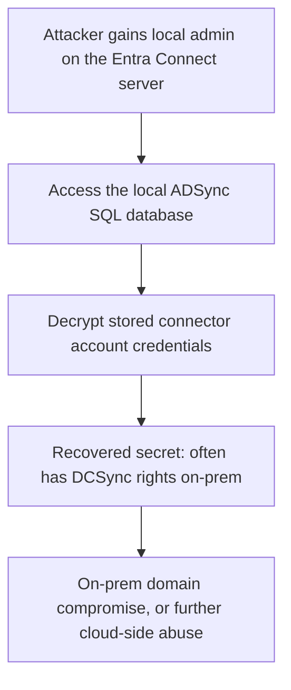

# Entra Connect credential extraction

Microsoft Entra Connect is the synchronization bridge between selected on-premises AD objects and a Microsoft Entra tenant. “Credential extraction” is meaningful only within the actual sync mode and host trust boundary.

> **Authorized assessment only:** This guide describes controlled, explicitly authorized assessment and defensive validation. It contains no target commands, exploit recipes, payloads, guessing parameters or real-target procedure.

## Beginner-friendly walkthrough

**In plain terms:** Entra Connect is the service that keeps an on-prem AD in sync with a cloud Microsoft Entra tenant, and to do that it must hold credential material of its own, locally, so it can read and write both sides. Whoever controls the server running Entra Connect effectively controls that trust bridge — recovering its stored secrets can mean recovering a way to act as synced accounts, or even forging cloud-side sign-ins.

**Objects abused / affected**

| Object | Normal purpose | What this technique touches |
| --- | --- | --- |
| ADSync service account | Reads/writes AD on behalf of the sync engine | Often holds powerful on-prem AD rights (sometimes DCSync-capable) by default |
| Local Entra Connect SQL database | Stores sync configuration and connector account secrets | Contains the material needed to decrypt stored credentials |
| Entra Connect server itself | Runs the sync engine | A single server compromise can therefore become a hybrid-identity compromise |

**Stages, and which tool typically covers each one**

1. **Prerequisite** — local admin (or equivalent) on the server actually running Entra Connect; this is a high-value target precisely because it bridges both environments.
2. **Extract the secret** — `AADInternals` is the best-known toolkit purpose-built for reading and decrypting the Entra Connect connector account credentials from the local sync database.
3. **Use the output** — the recovered connector account frequently has on-prem replication rights, feeding directly into [DCSync](dcsync.md); the same credential may also have cloud-side implications depending on the configured sync scope.

This is exactly why Microsoft documents the Entra Connect server as a Tier-0 asset deserving the same protection level as a domain controller — treating it as "just a sync box" is the actual root cause behind this technique's impact.

## Relevant objects and normal purpose

The sync server and ADSync service, connector configuration and staging database, AD and Entra connector identities, synchronization rules, KDS-related configuration where applicable, and corresponding on-premises/cloud accounts are the principal objects.

## Prerequisite chain

A review requires administrative or protected backup access to the sync host, a defined sync mode (password-hash, pass-through, staging, or staged rules), and evidence of connector permissions. Host privilege is not automatically Microsoft Entra privileged role membership.

## Impact limits and failure cases

Impact depends on connector account permissions, tenant role assignments, sync scope, password-hash/pass-through mode, hybrid sign-in configuration, and tenant protections. A staging host or database copy may not contain usable cloud credentials.

## Detection and validation

Correlate ADSync service and installer activity, changes to synchronization rules/connectors, database or key file access, sync-cycle and export/import logs, on-premises directory changes, and Entra sign-ins or role changes by the connector or sync account.

Validate an impact hypothesis by correlating the relevant identity, directory, authentication, endpoint, network or cloud telemetry for the exact host, account and time. One event ID or tool label is not proof of success.

## Mitigation and recovery

**Mitigation:** Restrict interactive/RDP access and tier the sync server; use dedicated, patched hosts; limit connector and tenant role permissions; protect the database/configuration and supported secrets; and inventory synchronization rules. Suspected compromise should isolate the host, preserve evidence, use Microsoft-supported credential rotation/recovery procedures, review sync and tenant changes, and validate clean synchronization before reactivation.

**Recovery:** Preserve evidence, isolate affected systems and identities, remove unauthorized state through approved procedures, review relevant credentials/sessions and retest in a clean lab.

## References

- [Microsoft Entra Connect deployment and security](https://learn.microsoft.com/entra/identity/hybrid/connect/how-to-connect-install-roadmap)
- [Microsoft Entra Connect staging server](https://learn.microsoft.com/entra/identity/hybrid/connect/how-to-connect-sync-staging-server)
- [Microsoft: Microsoft Entra identity documentation](https://learn.microsoft.com/entra/identity/)
- [Microsoft: Conditional Access](https://learn.microsoft.com/entra/identity/conditional-access/overview)
- [MITRE ATT&CK: T1552.001](https://attack.mitre.org/techniques/T1552/001/)
