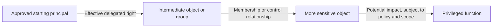

# ACL abuse (DACL misconfigurations)

## Concept

Active Directory objects—users, groups, computers, organizational units (OUs), and Group Policy Objects (GPOs)—have security descriptors. Their discretionary access control lists (DACLs) grant principals specific rights. ACL abuse is the risk that a principal already within an assessment’s authorized scope has excessive or unintended control over a more sensitive object. This is an authorization-path problem, not necessarily a software flaw: benign delegation, inherited permissions, and stale exceptions can combine into a path to elevated control.

A useful assessment follows rights and group membership from a known, approved starting principal to the affected object. It does not assume that a named permission automatically yields domain compromise; object type, inheritance, protected-object behavior, access-control semantics, and downstream controls all matter.

## Prerequisites and affected objects

The assessment needs an authorized identity or a reviewed directory snapshot, a defined scope, and enough context to resolve object ownership, group membership, inheritance, and effective access. Relevant objects include privileged groups, service identities, computer accounts, OUs, GPOs, and the domain naming context. Confirm whether an ACE is explicit or inherited, whether it applies to the object or descendants, and whether the principal is enabled and reachable through current group membership.

Examples of consequential rights include broad control (`GenericAll`), modifying permissions (`WriteDacl`), changing ownership (`WriteOwner`), password-reset extended rights, and rights to modify group membership. Attribute-writing rights may affect only selected properties; their significance depends on the attribute, object, and its consumers. A right on a GPO or OU can have a different blast radius from the same right on an ordinary user.

## Assessment model

Document the starting principal, the exact effective ACE and its source, the target object’s sensitivity, and the shortest plausible path to impact. Validate conclusions against directory configuration and policy without exercising changes to production objects. Use approved graph or ACL review tooling only within the engagement’s collection rules; this guide intentionally omits operational command sequences.

## Detection

Directory Service Changes auditing can produce Event 5136 for modifications to directory objects, including security-related changes when appropriate auditing is configured. Correlate changes to sensitive objects with the actor, source host, change window, and approved change records. Monitor changes to privileged group membership, object ownership, DACLs, GPO links, and sensitive attributes. A 5136 event is not guaranteed for every relevant change unless auditing and SACLs are correctly configured; validate coverage and retention.

## Remediation

Remove unnecessary ACEs, narrow delegated scope and inheritance, and grant only the minimum rights required. Review privileged groups, service identities, computer-object delegation, OU/GPO permissions, and vendor-created entries periodically. Track justified exceptions with an owner and expiry. Reassess AdminSDHolder and protected accounts where relevant; protected-object behavior can alter inheritance and does not itself fix every permission issue.

## Limits and related topics

An ACL finding establishes a potential authorization path, not proof that the path was used or that every intermediate operation would succeed. Effective rights depend on token membership, deny ACEs, inheritance, object-specific ACEs, and environmental controls. See [AdminSDHolder](adminsdholder.md), [DCSync](dcsync.md), and [BloodHound collection](bloodhound_collect.md).
