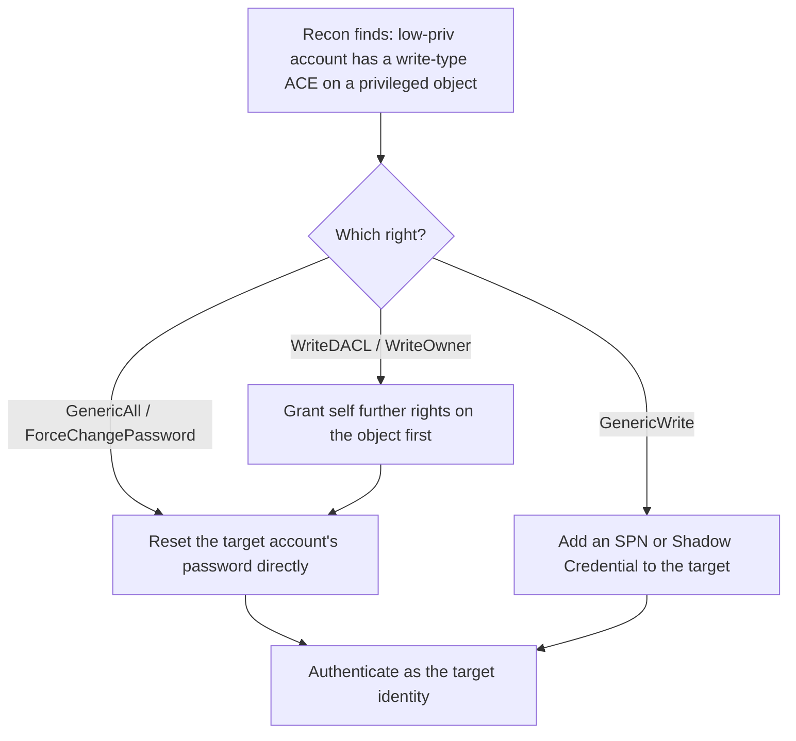

# ACL abuse (GenericAll / WriteDACL / ForceChangePassword)

AD object ACLs can grant an identity rights to alter another object or its authentication-related attributes. The abuse hypothesis is about effective access, not merely a visible ACE.

> **Authorized assessment only:** This guide describes controlled, explicitly authorized red-team assessment, lab practice, and defensive validation. It contains no target commands, exploit recipes, payloads, guessing parameters or real-target procedure.

## Beginner-friendly walkthrough

**In plain terms:** Active Directory objects each have a permission list (an ACL), just like a file or folder. Most people only check "is this account a member of a privileged group?" — but a non-privileged account that merely has *write* rights over a privileged user, group, or computer object can often get to the same place indirectly: change that object's password, add itself to a group, or alter its authentication material.

**Objects abused / affected**

| Right | Normal purpose | How it's abused |
| --- | --- | --- |
| `GenericAll` | Full control over the object | Can reset the target's password, add it to groups, edit any attribute |
| `GenericWrite` | Write most attributes | Can write a new SPN (→ targeted Kerberoast) or a Shadow Credential |
| `WriteDACL` | Modify the object's own permission list | Can grant itself `GenericAll` afterward, even without having it directly |
| `ForceChangePassword` | Reset the target's password without knowing the old one | Direct account takeover |
| `WriteOwner` | Change who owns the object | New owner can then grant itself further rights |



**Stages, and which tool typically covers each one**

1. **Find the edge** — this is the direct payoff of [LDAP enumeration](ldap_enum.md); `PowerView`'s ACL-focused cmdlets and `ADCollector` are built specifically to surface these relationships.
2. **Exercise the right** — `BloodyAD` is a cross-platform tool purpose-built for acting on exactly these AD rights (password resets, group writes, attribute writes) once BloodHound/PowerView has identified the edge.
3. **Fallback/scripted path** — `Impacket`'s relevant helper scripts can perform the same password-reset/attribute-write operations from Linux.

Reference shape of the finding (not a live query result):

```text
Principal: CORP\helpdesk-svc
Target:    CN=Domain Admins,CN=Users,DC=corp,DC=local
Right:     WriteDACL
```

A help-desk service account with `WriteDACL` over Domain Admins is a textbook example of a "quiet" privilege-escalation path that group-membership review alone would never catch.


## Relevant objects and normal purpose

Security descriptors contain owners and DACL/SACL ACEs. Relevant rights include WriteProperty, GenericWrite, GenericAll, WriteDacl, WriteOwner, and group/attribute-specific write. Object type, inheritance, ACE type, group nesting, and target state determine whether a right is usable.

## Prerequisite chain

The principal must have effective write/owner rights and reach a writable DC or management API. The target operation must also be allowed, and protected-group/SDPROP or RODC behavior may block or delay the result.


## Impact limits and failure cases

Inheritance, nested groups, denied ACEs, RODC scope, AdminSDHolder/SDPROP, foreign security principals, and the target attribute can narrow impact. Read/write ACE names do not prove which operation will succeed or that an identity becomes privileged.

## Detection and validation

Use directory audit event 5136 for object changes, privilege/group events 4724/4728/4732/4742 and 4662 as applicable. Correlate actor, target DN, old/new values, source host, group nesting, and replication; baseline delegated helpdesk changes.

Validate an impact hypothesis by correlating the relevant identity, directory, authentication, endpoint, network or cloud telemetry for the exact host, account and time. One event ID or tool label is not proof of success.

## Mitigation and recovery

**Mitigation:** Remove unnecessary write/owner rights and broad groups, replace with documented scoped delegation, review AdminSDHolder and sensitive object ACLs, and separate privileged tiers.

**Recovery:** Preserve evidence, isolate affected systems and identities, remove unauthorized state through approved procedures, review relevant credentials/sessions and retest in a clean lab.

## References

- [Microsoft: Active Directory Domain Services](https://learn.microsoft.com/windows-server/identity/ad-ds/)
- [Microsoft: Security auditing](https://learn.microsoft.com/windows/security/threat-protection/auditing/security-auditing-overview)
- [MITRE ATT&CK: T1222](https://attack.mitre.org/techniques/T1222/)
- [MITRE ATT&CK: T1098](https://attack.mitre.org/techniques/T1098/)
