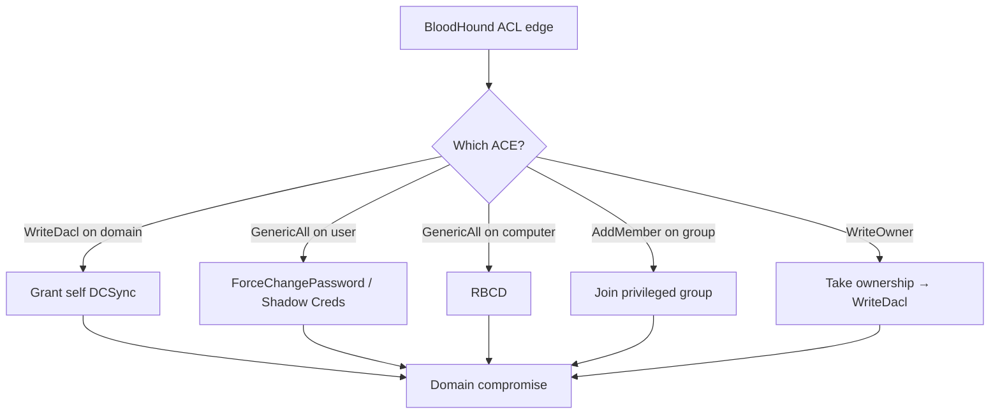

# ACL abuse (GenericAll / WriteDACL / ForceChangePassword)

### Affected object / attribute
**`nTSecurityDescriptor`** on any AD object: domain root, users, computers, groups, OUs, GPOs, AdminSDHolder.

### Concept (deep)
AD ACLs are the **permissions layer** of AD. BloodHound visualises dangerous ACEs as edges. Abuse of `GenericAll`, `GenericWrite`, `WriteDacl`, `WriteOwner`, `AddMember`, `AddKeyCredentialLink`, `ReadLAPSPassword`, `ReadGMSAPassword` turns a low-priv principal into a privileged one **without exploitation**. The most impactful edge is **`WriteDacl` on the domain object**, which allows granting yourself **DCSync rights**.

### Attack flow (Mermaid)


### Exhaustive commands
```bash
