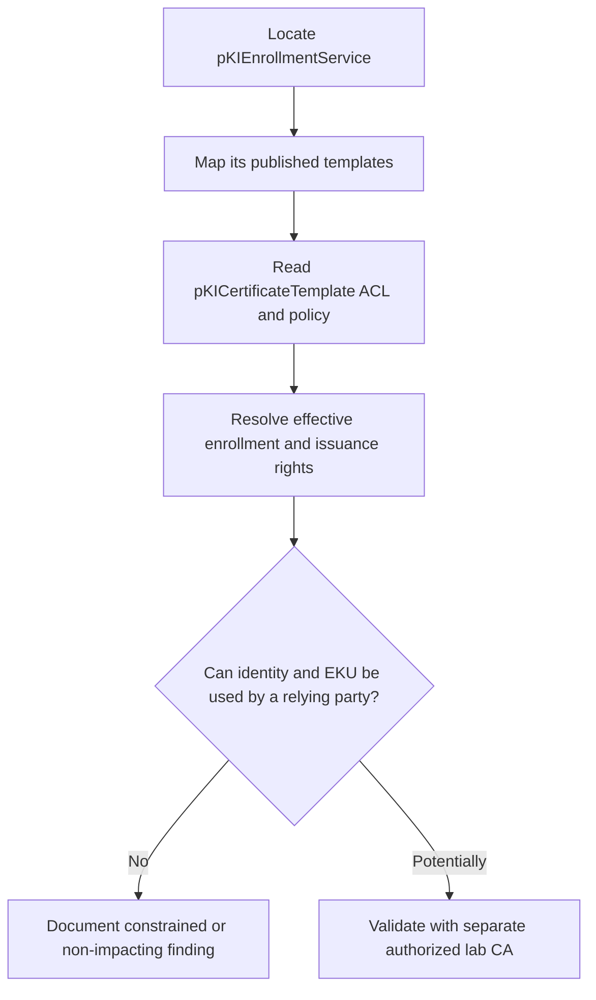

# AD CS template and CA enumeration

Inventorying Active Directory Certificate Services establishes which enterprise CAs exist, which templates each publishes, who can enroll or modify each template, and whether certificate identity and authentication settings make a configuration usable for the stated purpose. Enumeration is discovery and validation—not proof of a certificate identity abuse path.

> **Authorized assessment only:** Keep collection read-only unless written rules of engagement separately authorize issuance or configuration changes. Do not request certificates or alter published templates on real production systems.

## Objects and normal purpose

AD CS enterprise configuration is in the Active Directory Configuration naming context. Start with these objects and preserve their distinguished names.

| Object | Normal purpose | What to establish |
| --- | --- | --- |
| `pKIEnrollmentService` | Registers an enterprise CA and publishes the templates available for issuance | CA name/host, certificate and trust chain, enabled enrollment interfaces, published-template list |
| `pKICertificateTemplate` | Defines a reusable certificate policy and issuance controls | Template schema/display name, effective enrollment rights, subject/identity behavior, EKU, approval and RA policy |
| `certificationAuthority` / CA object | Represents a CA certificate and trust/chain relationship | Issuing/renewal certificate, CRL/OCSP locations, host and administrative scope |
| `msPKI-Enterprise-Oid` / OID containers | Define application-policy or issuance OIDs referenced by templates | Whether an OID is recognized as an authentication or other identity-bearing purpose by relying parties |

A template may exist in AD without being published by any CA. Publishing a template does not make it usable if the assessed principal lacks effective enrollment rights or the CA/template policy rejects issuance.

## Template attributes to inspect

| Attribute | Meaning | Review question |
| --- | --- | --- |
| `nTSecurityDescriptor` | Template DACL for read, enroll, autoenroll and modify rights | Which principals have effective rights, including inherited and nested groups? |
| `msPKI-Certificate-Name-Flag` | Controls subject and SAN construction | Is identity directory-derived or can a requester supply identity data? |
| `msPKI-Enrollment-Flag` | Enrollment behavior and approval-related settings | Is manager approval or another controlled state required and enforced? |
| `msPKI-RA-Signature` | Required authorized registration-authority signatures | Is the signature count/policy actually satisfied through controlled roles? |
| `pKIExtendedKeyUsage` | Certificate purposes | Does it include client authentication, smart-card logon or an application policy accepted for identity? |
| `pKIKeyUsage` | Cryptographic key usages | Are usage values compatible with the intended protocol and CA policy? |
| `msPKI-Certificate-Application-Policy` | Application-policy OIDs | Is the OID recognized and trusted for the intended authentication or signing use? |
| `pKIExpirationPeriod`, overlap and renewal values | Lifetime and renewal behavior | Does validity exceed policy or create avoidable revocation exposure? |
| `msPKI-Minimal-Key-Size` and key-specification settings | Key requirements | Are modern key sizes and algorithms required and enforced? |

Interpret attributes together. A requester-controlled SAN is not enough for unintended identity if the template is unpublished, enrollment is denied, approval or RA-signature policy blocks issuance, the EKU is not accepted for authentication, or the chain is not trusted.

## Conceptual assessment chain

## Safe read-only workflow

1. Record scope: domains, CAs, assessed principals, collection methods and time window. Do not enroll or modify objects unless separately authorized.
2. Inventory `pKIEnrollmentService` objects and compare them with each CA’s published-template list.
3. Resolve the template `nTSecurityDescriptor`, including inherited and nested groups. Separate read, enroll, autoenroll and modify rights.
4. Review name flags, EKUs/application policies, enrollment and approval flags, RA-signature count, key size and validity.
5. Examine CA host/service, chain, revocation and policy settings that affect whether a certificate is accepted.
6. Use an isolated or separately authorized lab for proof; record object DNs, effective principals and exact settings.
7. Report the normal business need and least-privilege remediation; redact certificate/private-key material and sensitive account data.

Do not include target enrollment, relay, certificate authentication or name-substitution commands in the assessment guide or report.

## Defensive validation and telemetry

- CA request/issuance events 4886/4887, with template, requester, subject/SAN, EKU, approver and source host when available.
- Directory audit event 5136 or equivalent for template, CA and OID object changes.
- Enrollment-service, IIS/RPC/HTTP, template ACL, approval and CA policy changes.
- Certificate authentication baseline: requester/source, subject/SAN/UPN, EKU, certificate chain, time and approved workflow.
- CRL/OCSP and revocation state for certificates identified in an approved investigation.

Event schemas vary by Windows Server build and audit configuration. Correlate directory, CA, authentication, endpoint and relying-party logs.

## Mitigation and recovery

Remove unused templates/interfaces, publish only required templates, restrict enrollment and modification to documented roles, and use directory-derived identity names for authentication templates. Require approval or authorized-signature controls for high-value issuance. Protect CA hosts, private keys and administrators as Tier-0 assets.

On suspicion, preserve CA and directory evidence, revoke only certificates with verified misuse, remove unsafe publication or policy, review requester/approver accounts, and assess relying-party authentication. Restore a template or ACL only from an approved known-good configuration and retest in the lab.

## Reporting checklist

- Enterprise CA name/host, issuing chain and published-template relationship.
- Template DN, display/schema name and relevant attribute values.
- Effective enrollment/autoenrollment/modification principals, including inherited/nested groups.
- Identity construction, EKUs/application policies, approval/RA-signature and validity settings.
- Preconditions confirmed, rejected or not testable.
- Relying-party trust and certificate acceptance evidence.
- Remediation owner, rollback/recovery plan and verification criteria.

## Practice lab

- [Hack The Box: Certified](https://app.hackthebox.com/machines/Certified) is a retired Windows/AD lab commonly used to study certificate-template and certificate-mapping weaknesses. Treat it as a bounded exercise, follow the platform rules, and do not transfer the workflow to systems outside the lab.
- The [AD CS ESC overview](adcs_esc_matrix.md) summarizes the commonly numbered ESC1–ESC16 categories and the defensive questions to ask for each. The labels describe different configuration and trust failures; they are not proof that a path is exploitable.

## References

- [Microsoft: Active Directory Certificate Services overview](https://learn.microsoft.com/windows-server/identity/ad-cs/active-directory-certificate-services-overview)
- [Microsoft: Certificate template concepts](https://learn.microsoft.com/windows-server/identity/ad-cs/certificate-template-concepts)
- [Microsoft Open Specifications: MS-WCCE Certificate Enrollment](https://learn.microsoft.com/openspecs/windows_protocols/ms-wcce/)
- [SpecterOps: Certified Pre-Owned](https://specterops.io/wp-content/uploads/sites/3/2022/06/Certified_Pre-Owned.pdf)
- [MITRE ATT&CK: T1649](https://attack.mitre.org/techniques/T1649/)
