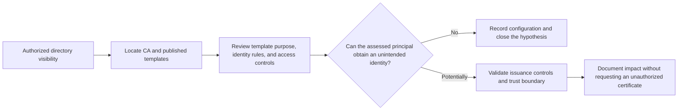

Inventory Active Directory Certificate Services (AD CS) configuration to understand which certificate authorities (CAs) issue which certificates, who can enroll, and which identities a certificate could represent. Enumeration is a discovery and validation activity, not proof of exploitability: a risky path exists only when the relevant template is published, an assessed principal can use it, issuance controls permit the request, and the resulting certificate is trusted for a useful purpose.

## Prerequisite
An authorized directory account with read access to the relevant AD CS configuration. Most configuration is readable by ordinary domain users; CA administration, template modification, and certificate enrollment are separate permissions.

## How it works

AD CS configuration is stored in the Active Directory Configuration naming context. Two object types are especially useful:

| Directory object | What it represents | What to establish during review |
| --- | --- | --- |
| `pKIEnrollmentService` | An enterprise CA registered in the directory | Which CA is present, which templates it publishes, and who can administer or use its enrollment interfaces |
| `pKICertificateTemplate` | A reusable certificate policy and issuance configuration | Who may enroll, what identity fields are allowed, what the certificate can be used for, and whether approval or authorized signatures are required |

A template can exist in the directory without being issued by any CA. Conversely, a published template may be available to a broad group. Always connect the template object to the CA's published-template list before assessing exposure.

## Important template settings

| Setting or attribute | Why it matters | Review question |
| --- | --- | --- |
| `nTSecurityDescriptor` | Carries the template's access-control entries | Which principals can read, enroll, autoenroll, or change the template? Are these rights inherited or granted through nested groups? |
| `msPKI-Certificate-Name-Flag` | Controls how subject and alternative-name identity data is populated | Can an enrollee supply identity information, or is it derived from a trusted directory object? |
| `pKIExtendedKeyUsage` | Describes permitted certificate purposes | Does the certificate support client authentication, smart-card logon, or another identity-bearing use? |
| `msPKI-Enrollment-Flag` | Controls enrollment behavior, including approval-related options | Is manager approval or another issuance safeguard required and actually enforced? |
| `msPKI-RA-Signature` and related RA policy | Describes authorized-signature requirements | Are required signatures configured and obtained through a controlled process? |
| `pKIExpirationPeriod` and renewal settings | Define certificate lifetime and renewal behavior | Could a certificate remain useful longer than intended, and can it be revoked effectively? |

These settings must be interpreted together. For example, requester-controlled identity data is not by itself a privilege path if the template is not published, the principal cannot enroll, the CA refuses issuance, or the certificate is not accepted for authentication. Likewise, an authentication-capable template does not by itself allow an enrollee to choose another identity.

## Conceptual risk path

In an abuse scenario, a combination of overly broad enrollment rights, permissive identity construction, authentication-capable certificate use, and insufficient issuance controls can allow a certificate to represent an identity other than the requester. If accepted by domain authentication, that identity may carry its existing directory permissions. Enumeration should identify and document the configuration chain; do not assume the highest-privilege outcome or attempt enrollment outside the written assessment scope.

## Read-only assessment workflow

1. **Confirm scope.** Record the domains, CAs, principals, and collection methods explicitly authorized by the engagement. Avoid requesting certificates or changing directory objects unless the rules of engagement separately authorize that test.
2. **Inventory CAs and templates.** Identify enterprise CA objects and the templates each CA publishes. Keep the CA-to-template relationship in the evidence; a template that is not published is not an available enrollment path through that CA.
3. **Resolve effective access.** Review the template and CA permissions, including group nesting and inherited rights. Distinguish read access from enrollment, autoenrollment, and configuration-change rights.
4. **Evaluate identity and purpose.** Check subject-name controls, authentication-related EKUs, issuance requirements, validity periods, and CA-level policy. Note which combinations are present rather than flagging a single attribute in isolation.
5. **Validate impact safely.** Compare the observed settings with approved business requirements and vendor guidance. Use a purpose-built lab or a separately authorized non-production test if proof of issuance is required.
6. **Report evidence and remediation.** Include the object distinguished name, CA, relevant settings, effective principal, expected business owner, impact conditions, and a least-privilege fix. Redact certificate material, account data, and other secrets from the report.

## Tools in an authorized assessment

The graph links [Certipy](https://github.com/ly4k/Certipy) and [Certify](https://github.com/GhostPack/Certify), which can help collect and summarize AD CS configuration. They are dual-use tools; choose read-only collection appropriate to the rules of engagement, review the output against the actual directory objects, and do not treat a tool's ESC label as a confirmed exploit. No enrollment, relay, or certificate-authentication commands are included here.

## Defensive checks

Inventory CAs and published templates as part of routine AD security reviews. Restrict enrollment and template modification to intended principals; avoid requester-supplied identity on authentication templates unless there is a documented need; require approval or authorized signatures for sensitive issuance; and remove unused templates and enrollment endpoints. Protect CA private keys and administrative groups as Tier-0 assets.

Monitor changes to template and CA objects, unexpected enrollment or autoenrollment, certificate requests whose requester and subject do not align with expected workflows, and use of certificates from unusual hosts. CA request/issuance events can help, but not every path produces identical logs; retain CA auditing and correlate it with directory changes, authentication events, and the endpoint that initiated the activity.

## Reporting checklist

- CA name and host; template name and whether it is currently published.
- Effective enrollment and modification principals, including nested groups.
- Identity-construction behavior and relevant certificate purposes.
- Approval, authorized-signature, validity, and revocation controls.
- Preconditions that must all hold before the issue has impact.
- Business justification, severity rationale, and a specific least-privilege remediation.
- Confirmation that validation was read-only or conducted in an explicitly authorized lab.

## References

- [MITRE ATT&CK: Steal or Forge Authentication Certificates](https://attack.mitre.org/techniques/T1649/)
- [Microsoft: Certificate templates](https://learn.microsoft.com/windows-server/identity/ad-cs/certificate-template-concepts)
- [Microsoft: Active Directory Certificate Services overview](https://learn.microsoft.com/windows-server/identity/ad-cs/active-directory-certificate-services-overview)
- [Microsoft Open Specifications: Certificate Services protocols](https://learn.microsoft.com/openspecs/windows_protocols/ms-wcce/)
- [SpecterOps: Certified Pre-Owned](https://specterops.io/wp-content/uploads/sites/3/2022/06/Certified_Pre-Owned.pdf)
