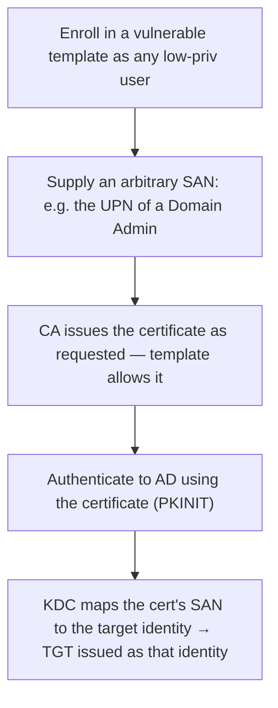
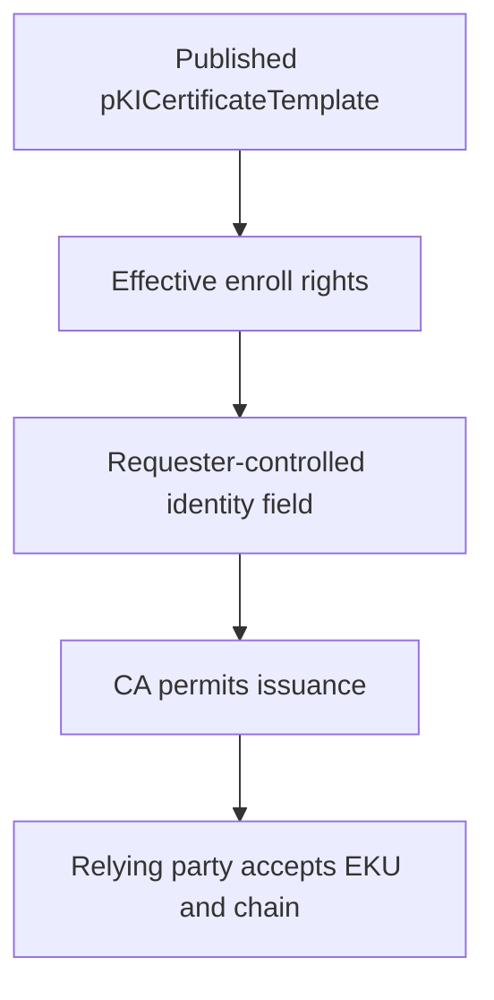

# ADCS ESC1

ESC1 is an AD CS misconfiguration class in which template enrollment and name/EKU policy permit a principal to obtain an authentication-capable certificate representing an identity outside the requester’s normal AD identity.

> **Authorized assessment only:** This guide is for controlled labs and explicitly authorized reviews. It provides no issuance commands, exploit recipes or credential-recovery procedure.

## Beginner-friendly walkthrough

**In plain terms:** AD Certificate Services lets you request a certificate that proves "I am this AD identity" to anything that trusts the CA — similar to how a passport proves identity to a border agent. ESC1 is a misconfigured certificate template that lets a low-privileged requester put *someone else's* identity on the passport application themselves (via the Subject Alternative Name field) and still get it approved and signed.

**Objects abused / affected**

| Object | Normal purpose | What ESC1 touches |
| --- | --- | --- |
| Certificate template | Defines who can enroll and what the resulting cert can be used for | Misconfigured to allow enrollee-supplied SAN + client authentication EKU + low-privilege enrollment rights, all at once |
| `CT_FLAG_ENROLLEE_SUPPLIES_SUBJECT` | Lets the requester specify their own subject/SAN | The actual vulnerable setting — it should normally be reserved for narrow, controlled cases |
| Client Authentication EKU | Marks a cert as valid for logging in, not just signing/encrypting | Combined with a spoofable SAN, this is what turns a cert into an impersonation tool |
| Issued certificate | Normally represents the requester's own identity | Instead represents whatever identity (e.g. a Domain Admin UPN) the requester typed in |



**Stages, and which tool typically covers each one**

1. **Find vulnerable templates** — `Certipy`'s enumeration mode (and `Certify` on Windows) reads template configuration via LDAP and flags templates matching the ESC1 condition (enrollee-supplied subject + client-auth EKU + broad enrollment rights).
2. **Request the certificate** — the same tools support submitting an enrollment request that sets the SAN to the target identity, assuming the enrolling account already has enrollment rights on the template.
3. **Authenticate with it** — the issued certificate is used for PKINIT (certificate-based Kerberos pre-authentication) to obtain a TGT as the impersonated identity.

Reference shape of the risky template setting (not a live enrollment):

```text
Template: WebServerAuth
msPKI-Certificate-Name-Flag: CT_FLAG_ENROLLEE_SUPPLIES_SUBJECT (set)
pKIExtendedKeyUsage: Client Authentication
Enrollment rights: Domain Users (Enroll)
```

The fix is to remove enrollee-supplied-subject from any template that also carries a client-authentication EKU, or restrict enrollment to accounts that should legitimately hold that identity.


## AD CS objects and normal purpose

An enterprise CA (`pKIEnrollmentService`) publishes `pKICertificateTemplate` objects. For an ESC1 hypothesis correlate `nTSecurityDescriptor`, `msPKI-Certificate-Name-Flag`, `msPKI-Enrollment-Flag`, `msPKI-RA-Signature`, `pKIExtendedKeyUsage`, application policies, validity and key settings. The normal purpose is controlled enrollment for a documented identity and certificate use.

## Prerequisite chain

The template must be published, the assessed principal needs effective enrollment rights, name policy must permit identity outside the requester’s normal identity, issuance approval/signature controls must permit the request, the EKU and certificate chain must be accepted for authentication or a useful purpose, and a relying party must trust the issuing chain.

## Affected object and fix

```text
Object: pKICertificateTemplate
Settings to review: nTSecurityDescriptor, msPKI-Certificate-Name-Flag, EKU, approval/signatures
Risky state: Broad enrollment plus requester-controlled identity on an authentication template
Fix target: Directory-derived identity, narrowly scoped enrollment, and enforced issuance controls
```



## Impact limits

Manager approval, authorized-signature/RA policy, directory-derived subject rules, template/CA policy modules, EKU, chain trust and relying-party authentication policy can block impact. A requester-controlled SAN or client-auth EKU is not enough when publication, trust or downstream acceptance is absent.

## Detection and validation

Correlate CA 4886/4887 issuance events with template, requester, subject/SAN, EKU, source host and approver. Directory audit 5136 can identify template/ACL changes. Baseline approved enrollment workflows and verify effective ACL/template values in the directory rather than relying on a tool’s ESC label.

## Mitigation and recovery

Remove unsafe publishing, restrict enrollment/template modification, require directory-derived subject names for authentication templates and add approval or authorized-signature policy where appropriate. Revoke only certificates with confirmed misuse, preserve CA and authentication evidence, remove unsafe template state and revalidate in a lab. Reset identities only if their authentication context was actually used.

## References

- [Microsoft: AD CS overview](https://learn.microsoft.com/windows-server/identity/ad-cs/active-directory-certificate-services-overview)
- [Microsoft: Certificate template concepts](https://learn.microsoft.com/windows-server/identity/ad-cs/certificate-template-concepts)
- [MITRE ATT&CK: T1649](https://attack.mitre.org/techniques/T1649/)
