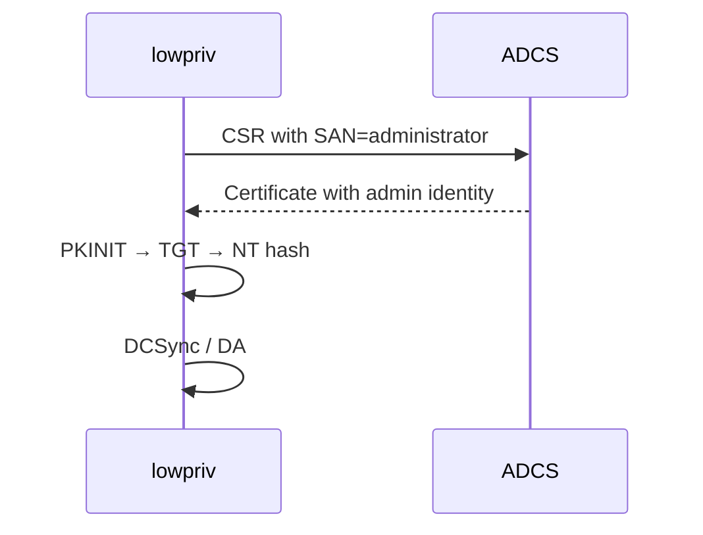

# ADCS ESC1

### Affected object / attribute
**Certificate template** with **enrollee-supplied SAN**, **Client Authentication EKU**, and low-priv enrolment rights.

### Concept (deep)
The template allows the requester to specify a **Subject Alternative Name**. The attacker requests a certificate with `administrator@corp.local` as the SAN. The CA issues a certificate that authenticates as the Domain Admin. The certificate is then used with **PKINIT** to obtain a TGT and the account’s NT hash.

### Attack flow (Mermaid)


### Exhaustive commands
```bash
