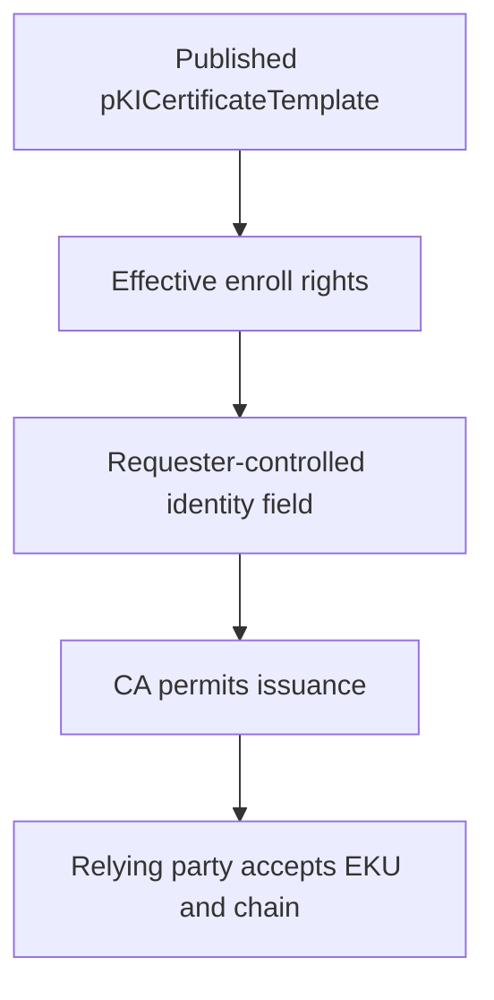

# ADCS ESC1

ESC1 is an AD CS misconfiguration class in which template enrollment and name/EKU policy permit a principal to obtain an authentication-capable certificate representing an identity outside the requester’s normal AD identity.

> **Authorized assessment only:** This guide is for controlled labs and explicitly authorized reviews. It provides no issuance commands, exploit recipes or credential-recovery procedure.

## AD CS objects and normal purpose

An enterprise CA (`pKIEnrollmentService`) publishes `pKICertificateTemplate` objects. For an ESC1 hypothesis correlate `nTSecurityDescriptor`, `msPKI-Certificate-Name-Flag`, `msPKI-Enrollment-Flag`, `msPKI-RA-Signature`, `pKIExtendedKeyUsage`, application policies, validity and key settings. The normal purpose is controlled enrollment for a documented identity and certificate use.

## Prerequisite chain

The template must be published, the assessed principal needs effective enrollment rights, name policy must permit identity outside the requester’s normal identity, issuance approval/signature controls must permit the request, the EKU and certificate chain must be accepted for authentication or a useful purpose, and a relying party must trust the issuing chain.

## Impact limits

Manager approval, authorized-signature/RA policy, directory-derived subject rules, template/CA policy modules, EKU, chain trust and relying-party authentication policy can block impact. A requester-controlled SAN or client-auth EKU is not enough when publication, trust or downstream acceptance is absent.

## Detection and validation

Correlate CA 4886/4887 issuance events with template, requester, subject/SAN, EKU, source host and approver. Directory audit 5136 can identify template/ACL changes. Baseline approved enrollment workflows and verify effective ACL/template values in the directory rather than relying on a tool’s ESC label.

## Mitigation and recovery

Remove unsafe publishing, restrict enrollment/template modification, require directory-derived subject names for authentication templates and add approval or authorized-signature policy where appropriate. Revoke only certificates with confirmed misuse, preserve CA and authentication evidence, remove unsafe template state and revalidate in a lab. Reset identities only if their authentication context was actually used.

## References

- [Microsoft: AD CS overview](https://learn.microsoft.com/windows-server/identity/ad-cs/active-directory-certificate-services-overview)
- [Microsoft: Certificate template concepts](https://learn.microsoft.com/windows-server/identity/ad-cs/certificate-template-concepts)
- [MITRE ATT&CK: T1649](https://attack.mitre.org/techniques/T1649/)
