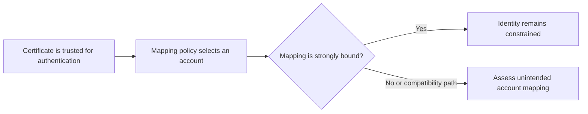

# AD CS ESC10: weak certificate mapping

ESC10 groups certificate-to-account mapping weaknesses associated with domain-controller policy and compatibility behavior. If a relying party accepts a certificate using a weak identity association, a valid certificate may be mapped differently than intended. Exact subcases depend on Windows version, policy and certificate fields.

> **Authorized assessment only:** Review mapping policy and event evidence. Do not test account mapping against production identities without written approval.

## Conceptual path

## Conditions and limits

The certificate must chain to a trusted CA and be accepted for the relevant authentication purpose. Mapping mode, certificate fields, account attributes, patch state and compatibility settings determine the outcome; a weak-mapping label alone does not prove a usable path.

## Defensive review

Apply Microsoft's current strong-certificate-binding guidance, remove unnecessary compatibility exceptions, and review account mapping attributes and permissions. Test smart-card, VPN and service integrations in a lab before policy changes.

## Detection

Correlate certificate authentication logs with certificate subject/SAN, issuer, account selected, mapping mode, source host and account state. Audit changes to mapping-related account attributes and domain-controller policy.

## References

- [AD CS ESC taxonomy overview](docs/techniques/adcs_esc_matrix.md)
- [Microsoft: KB5014754 certificate-based authentication changes](https://support.microsoft.com/kb/5014754)
- [MITRE ATT&CK: T1649](https://attack.mitre.org/techniques/T1649/)
