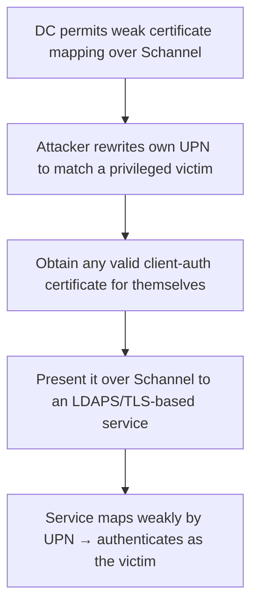
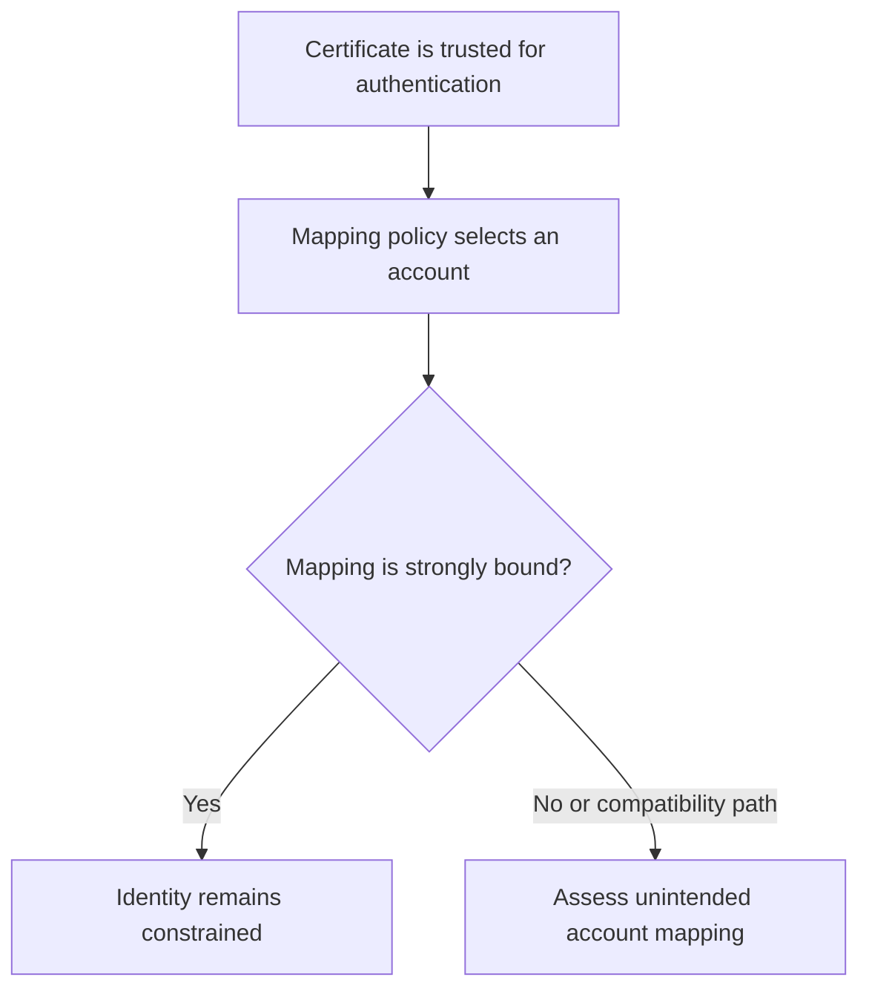

# AD CS ESC10: weak certificate mapping

ESC10 groups certificate-to-account mapping weaknesses associated with domain-controller policy and compatibility behavior. If a relying party accepts a certificate using a weak identity association, a valid certificate may be mapped differently than intended. Exact subcases depend on Windows version, policy and certificate fields.

> **Authorized assessment only:** Review mapping policy and event evidence. Do not test account mapping against production identities without written approval.

## Beginner-friendly walkthrough

**In plain terms:** ESC9 was about a template skipping the strong-binding extension. ESC10 is a
sibling issue, but on the authentication side instead of the certificate side: a domain
controller's `CertificateMappingMethods` registry setting controls how strictly it validates a
certificate presented over Schannel (TLS client-certificate authentication, used by LDAPS/IIS
and similar). If that setting still permits weak mapping, the same UPN-spoofing trick from ESC9
works through Schannel instead of through Kerberos PKINIT.

**Objects abused / affected**

| Object | Normal purpose | What ESC10 touches |
| --- | --- | --- |
| `CertificateMappingMethods` (DC registry setting) | Controls how strictly Schannel validates client certificates | Set to allow weak mapping types (e.g. UPN-only) instead of requiring the strong SID extension |
| Target account's UPN | Normally stable and unique | Rewritten by the attacker, same as in ESC9, to match a privileged victim |
| Schannel-authenticated service (e.g. LDAPS) | Normally trusts strong certificate-to-account binding | Accepts the weak mapping and authenticates as the spoofed identity |



**Stages, and which tool typically covers each one**

1. **Check the registry setting** — `Certipy`'s CA/DC enumeration helpers and manual registry review both surface whether `CertificateMappingMethods` still permits weak mapping.
2. **Exploit it** — the UPN-rewrite step is identical to [ESC9](adcs_esc9.md); only the protocol used to present the resulting certificate differs (Schannel instead of PKINIT).

Microsoft's phased rollout for strong certificate mapping (originally tied to the Certifried fix) applies to Schannel as well as Kerberos — checking current enforcement mode on every DC is the direct defensive step here.

**Where exact command syntax lives:** this repo deliberately keeps technique pages
command-free (see `CONTRIBUTING.md`). For copy-pasteable enumeration/exploitation syntax for
this exact ESC, the authoritative public sources are the [Certipy Wiki](https://github.com/ly4k/Certipy/wiki)
(the tool that implements detection/abuse for ESC1–ESC17), [HackTricks' AD CS domain escalation page](https://book.hacktricks.xyz/windows-hardening/active-directory-methodology/ad-certificates/domain-escalation),
and the [SpecterOps "Certificates and Pwnage and Patches, Oh My!" post](https://specterops.io/blog/2022/11/09/certificates-and-pwnage-and-patches-oh-my) that introduced several later ESCs.


## Conceptual path



## Conditions and limits

The certificate must chain to a trusted CA and be accepted for the relevant authentication purpose. Mapping mode, certificate fields, account attributes, patch state and compatibility settings determine the outcome; a weak-mapping label alone does not prove a usable path.

## Affected objects and fix

```text
Objects: Domain-controller certificate-mapping policy and mapped AD account attributes
Settings to review: Strong-binding policy, compatibility exceptions, explicit account mappings
Risky state: Weak or ambiguous mapping is accepted for certificate authentication
Fix target: Current Microsoft strong-binding policy; remove stale mappings and exceptions
```

## Defensive review

Apply Microsoft's current strong-certificate-binding guidance, remove unnecessary compatibility exceptions, and review account mapping attributes and permissions. Test smart-card, VPN and service integrations in a lab before policy changes.

## Detection

Correlate certificate authentication logs with certificate subject/SAN, issuer, account selected, mapping mode, source host and account state. Audit changes to mapping-related account attributes and domain-controller policy.

## References

- [AD CS ESC taxonomy overview](docs/techniques/adcs_esc_matrix.md)
- [Microsoft: KB5014754 certificate-based authentication changes](https://support.microsoft.com/kb/5014754)
- [MITRE ATT&CK: T1649](https://attack.mitre.org/techniques/T1649/)
