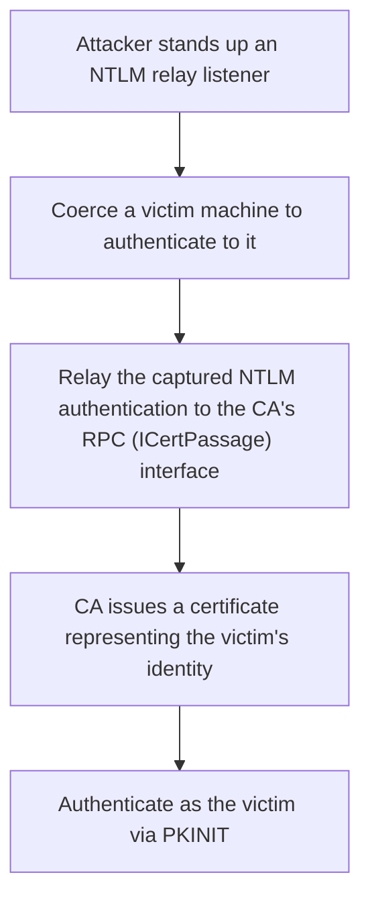
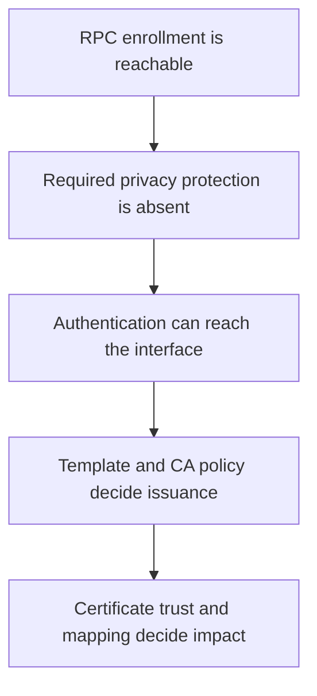

# AD CS ESC11: RPC enrollment relay exposure

ESC11 describes an RPC certificate-enrollment interface that does not enforce the required packet-privacy protection. Under specific network and authentication conditions, this can expose the enrollment service to relayed authentication. It is a service-protection issue, not proof that a certificate was issued.

> **Authorized assessment only:** Review endpoint configuration and telemetry. Do not induce authentication or relay traffic outside an explicitly authorized isolated lab.

## Beginner-friendly walkthrough

**In plain terms:** ESC8 relays coerced NTLM authentication to the CA's *HTTP* web enrollment
page. ESC11 is the same idea aimed at the CA's *RPC* interface instead (`ICertPassage`, used by
the standard `certreq`/`DCOM` enrollment path). If the CA hasn't enabled the RPC-level
encryption/integrity enforcement flag, the relay works here too, just over a different
transport.

**Objects abused / affected**

| Object | Normal purpose | What ESC11 touches |
| --- | --- | --- |
| `IF_ENFORCEENCRYPTICERTREQUEST` CA flag | Should force integrity-protected RPC certificate requests | When unset, RPC-based enrollment accepts a relayed NTLM session the same way the HTTP endpoint does in ESC8 |
| Coerced victim identity | Normally only authenticates to legitimate services | Tricked into authenticating toward the attacker's relay, as in ESC8 |
| Issued client-auth certificate | Represents the victim's identity | Obtained via the relayed RPC session |



**Stages, and which tool typically covers each one**

1. **Check the CA flag** — `Certipy`'s CA-enumeration mode reads whether `IF_ENFORCEENCRYPTICERTREQUEST` is set, the single setting that determines whether this path is viable.
2. **Coerce and relay** — identical coercion primitives to [ESC8](adcs_esc8.md), with the relay destination pointed at the RPC interface instead of HTTP.

This is why ESC8 and ESC11 are usually assessed together: fixing the HTTP endpoint (EPA/HTTPS) without also enforcing RPC request integrity leaves an equivalent path open.

**Where exact command syntax lives:** this repo deliberately keeps technique pages
command-free (see `CONTRIBUTING.md`). For copy-pasteable enumeration/exploitation syntax for
this exact ESC, the authoritative public sources are the [Certipy Wiki](https://github.com/ly4k/Certipy/wiki)
(the tool that implements detection/abuse for ESC1–ESC17), [HackTricks' AD CS domain escalation page](https://book.hacktricks.xyz/windows-hardening/active-directory-methodology/ad-certificates/domain-escalation),
and the [SpecterOps "Certificates and Pwnage and Patches, Oh My!" post](https://specterops.io/blog/2022/11/09/certificates-and-pwnage-and-patches-oh-my) that introduced several later ESCs.


## Conceptual path



## Conditions and limits

Reachability, authentication protocol, enforced RPC privacy, NTLM controls, template enrollment rights, approval, EKU and downstream trust all matter. Network reachability or an exposed interface alone is not evidence of certificate issuance or privilege.

## Affected object and fix

```text
Object: CA RPC enrollment endpoint and its security configuration
Setting to review: Whether RPC packet privacy is enforced for enrollment
Risky state: Enrollment accepts a connection without the required privacy protection
Fix target: Enforce packet privacy, disable unused enrollment interfaces, and restrict NTLM paths
```

## Defensive review

Require packet privacy for RPC enrollment, disable unused enrollment interfaces, restrict NTLM relay paths and limit template enrollment. Validate changes against legitimate enrollment clients in a lab.

## Detection

Correlate RPC enrollment connections, NTLM authentication, CA request/issuance events 4886/4887, template, requester, source host and later certificate use. Baseline normal enrollment clients and destinations.

## References

- [AD CS ESC taxonomy overview](docs/techniques/adcs_esc_matrix.md)
- [Microsoft Open Specifications: MS-WCCE Certificate Enrollment](https://learn.microsoft.com/openspecs/windows_protocols/ms-wcce/)
- [MITRE ATT&CK: T1649](https://attack.mitre.org/techniques/T1649/)
