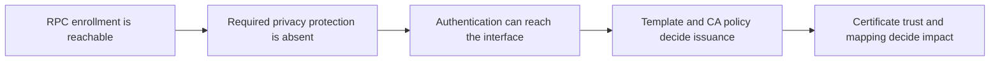

# AD CS ESC11: RPC enrollment relay exposure

ESC11 describes an RPC certificate-enrollment interface that does not enforce the required packet-privacy protection. Under specific network and authentication conditions, this can expose the enrollment service to relayed authentication. It is a service-protection issue, not proof that a certificate was issued.

> **Authorized assessment only:** Review endpoint configuration and telemetry. Do not induce authentication or relay traffic outside an explicitly authorized isolated lab.

## Conceptual path



## Conditions and limits

Reachability, authentication protocol, enforced RPC privacy, NTLM controls, template enrollment rights, approval, EKU and downstream trust all matter. Network reachability or an exposed interface alone is not evidence of certificate issuance or privilege.

## Affected object and fix

```text
Object: CA RPC enrollment endpoint and its security configuration
Setting to review: Whether RPC packet privacy is enforced for enrollment
Risky state: Enrollment accepts a connection without the required privacy protection
Fix target: Enforce packet privacy, disable unused enrollment interfaces, and restrict NTLM paths
```

## Defensive review

Require packet privacy for RPC enrollment, disable unused enrollment interfaces, restrict NTLM relay paths and limit template enrollment. Validate changes against legitimate enrollment clients in a lab.

## Detection

Correlate RPC enrollment connections, NTLM authentication, CA request/issuance events 4886/4887, template, requester, source host and later certificate use. Baseline normal enrollment clients and destinations.

## References

- [AD CS ESC taxonomy overview](docs/techniques/adcs_esc_matrix.md)
- [Microsoft Open Specifications: MS-WCCE Certificate Enrollment](https://learn.microsoft.com/openspecs/windows_protocols/ms-wcce/)
- [MITRE ATT&CK: T1649](https://attack.mitre.org/techniques/T1649/)
