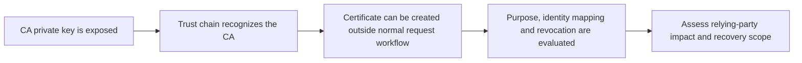

# AD CS ESC12: CA signing-key exposure

ESC12 concerns exposure of a CA signing private key to principals or systems that should not access it. Control of a trusted CA key can undermine normal issuance controls, but impact depends on the key, chain trust, certificate purpose, mapping and relying-party validation.

> **Authorized assessment only:** Treat CA key material as highly sensitive. Do not extract, copy or use it during an assessment without explicit written authorization and a dedicated lab.

## Conceptual path

## Conditions and limits

Access to a public CA certificate is not private-key compromise. The key must be usable for the relevant signing chain, and relying parties must accept the resulting certificate. Revocation, expiry, strong mapping and chain changes affect impact and recovery.

## Defensive review

Protect CA hosts as Tier-0 systems. Store keys in appropriate HSM/TPM-backed controls where feasible, restrict export and administrative access, keep recovery material protected, and monitor key operations.

## Detection and recovery

Correlate key access/export, CA host integrity, CA request records, certificates not represented in expected workflows and certificate-authentication events. If exposure is credible, preserve evidence and coordinate CA recovery, trust-chain rotation and certificate revocation with PKI owners.

## References

- [AD CS ESC taxonomy overview](docs/techniques/adcs_esc_matrix.md)
- [Microsoft: Active Directory Certificate Services overview](https://learn.microsoft.com/windows-server/identity/ad-cs/active-directory-certificate-services-overview)
- [MITRE ATT&CK: T1649](https://attack.mitre.org/techniques/T1649/)
