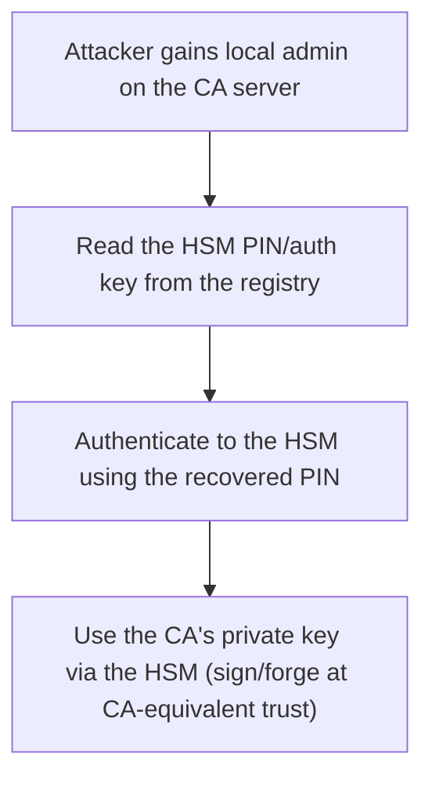
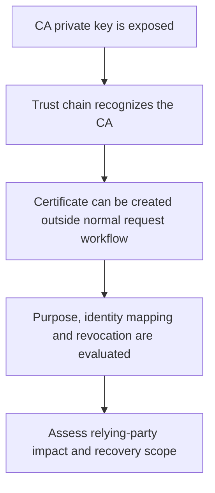

# AD CS ESC12: CA signing-key exposure

ESC12 concerns exposure of a CA signing private key to principals or systems that should not access it. Control of a trusted CA key can undermine normal issuance controls, but impact depends on the key, chain trust, certificate purpose, mapping and relying-party validation.

> **Authorized assessment only:** Treat CA key material as highly sensitive. Do not extract, copy or use it during an assessment without explicit written authorization and a dedicated lab.

## Beginner-friendly walkthrough

**In plain terms:** a CA's private key is sometimes stored on a dedicated hardware security
device (e.g. a YubiHSM2) rather than in Windows' own key store, specifically so the key can't be
exported even by an administrator. ESC12 is what happens when the PIN needed to unlock that
device ends up stored in the Windows registry on the CA server anyway — an admin on that one
server can read the PIN and use it to operate the HSM, defeating the entire point of using
dedicated hardware.

**Objects abused / affected**

| Object | Normal purpose | What ESC12 touches |
| --- | --- | --- |
| CA private key on an HSM | Meant to be non-exportable, hardware-protected | Can still be *used* (not necessarily exported) by anyone who can authenticate to the HSM |
| HSM PIN/auth key in the registry | Needed by the CA service to use the HSM automatically | Readable by a local admin on the CA server, defeating the hardware protection |



**Stages, and which tool typically covers each one**

1. **Prerequisite** — local admin on the CA server; this is a post-exploitation technique, not a remote attack.
2. **Recover the PIN and use the HSM** — this is largely a manual, host-specific step (reading a documented registry location and interacting with the vendor's HSM client tooling) rather than something generic AD CS tools automate end-to-end.

The practical fix is organizational as much as technical: if a CA key lives on an HSM specifically for non-repudiation/export-protection reasons, the PIN needs equivalent protection — not a plaintext registry value readable by the same admins the HSM was meant to be protected from.

**Where exact command syntax lives:** this repo deliberately keeps technique pages
command-free (see `CONTRIBUTING.md`). For copy-pasteable enumeration/exploitation syntax for
this exact ESC, the authoritative public sources are the [Certipy Wiki](https://github.com/ly4k/Certipy/wiki)
(the tool that implements detection/abuse for ESC1–ESC17) and [HackTricks' AD CS domain escalation page](https://book.hacktricks.xyz/windows-hardening/active-directory-methodology/ad-certificates/domain-escalation).


## Conceptual path



## Conditions and limits

Access to a public CA certificate is not private-key compromise. The key must be usable for the relevant signing chain, and relying parties must accept the resulting certificate. Revocation, expiry, strong mapping and chain changes affect impact and recovery.

## Affected object and fix

```text
Object: CA signing private key and CA host
Settings to review: Key storage/exportability, key ACLs, host administrators, backups
Risky state: Unapproved identity can access or export signing capability
Fix target: Protected key storage, restricted Tier-0 access, monitored key operations
```

## Defensive review

Protect CA hosts as Tier-0 systems. Store keys in appropriate HSM/TPM-backed controls where feasible, restrict export and administrative access, keep recovery material protected, and monitor key operations.

## Detection and recovery

Correlate key access/export, CA host integrity, CA request records, certificates not represented in expected workflows and certificate-authentication events. If exposure is credible, preserve evidence and coordinate CA recovery, trust-chain rotation and certificate revocation with PKI owners.

## References

- [AD CS ESC taxonomy overview](docs/techniques/adcs_esc_matrix.md)
- [Microsoft: Active Directory Certificate Services overview](https://learn.microsoft.com/windows-server/identity/ad-cs/active-directory-certificate-services-overview)
- [MITRE ATT&CK: T1649](https://attack.mitre.org/techniques/T1649/)
