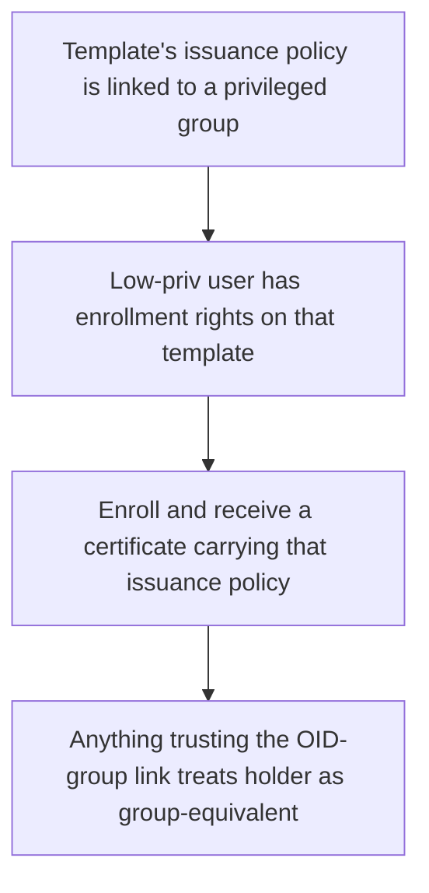
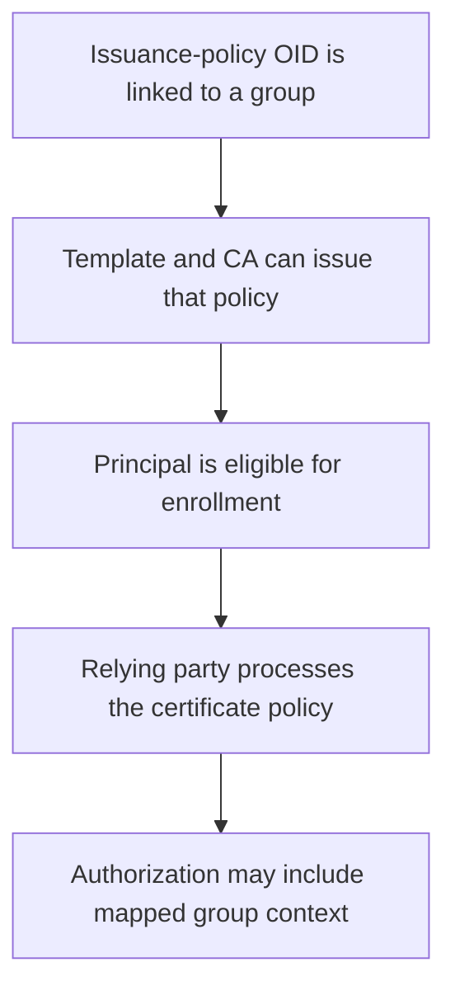

# AD CS ESC13: issuance-policy group mapping

ESC13 concerns an issuance-policy object linked to a privileged group so that a certificate carrying the corresponding policy can influence authorization when accepted. This depends on the directory's OID-to-group configuration and the relying party's processing of the policy.

> **Authorized assessment only:** Inspect OID links and template policy read-only. Do not alter group links or issue test certificates in production.

## Beginner-friendly walkthrough

**In plain terms:** AD CS supports "issuance policies" — labels that can be attached to a
certificate template and then linked (via `msDS-OIDToGroupLink`) to a specific AD group, so that
possessing a certificate with that policy is treated, by anything checking that link, as
equivalent to being a member of the linked group. ESC13 is a template with lenient enrollment
whose issuance policy happens to be linked to a *privileged* group — so enrolling in an
otherwise-unremarkable template can grant the practical equivalent of that group's membership.

**Objects abused / affected**

| Object | Normal purpose | What ESC13 touches |
| --- | --- | --- |
| Issuance policy object | Labels what a certificate "means" for authorization purposes | Linked via `msDS-OIDToGroupLink` to a privileged group |
| Certificate template referencing that policy | Defines who can enroll | Enrollable by a broader population than the linked group's real membership |
| Anything that authorizes based on the issuance-policy OID | Treats policy possession as group-equivalent | Grants privileged-equivalent access to anyone holding the resulting certificate |



**Stages, and which tool typically covers each one**

1. **Find the link** — `Certipy` can identify templates vulnerable to ESC13 (issuance policy linked to a group) directly, though per its own documentation it does not fully map out what privileges that group grants — that part needs `BloodHound`, which is specifically good at graph-based ESCs like this one and ESC5/ESC14.
2. **Enroll** — straightforward template enrollment, same as any other technique here, once the link and the enrollment right are both confirmed.

This is a newer and more subtle class of finding than ESC1–ESC8 — it rewards reviewing issuance-policy-to-group links as part of routine AD CS hygiene, not just template EKU/SAN settings.

**Where exact command syntax lives:** this repo deliberately keeps technique pages
command-free (see `CONTRIBUTING.md`). For copy-pasteable enumeration/exploitation syntax for
this exact ESC, the authoritative public sources are the [Certipy Wiki](https://github.com/ly4k/Certipy/wiki)
(the tool that implements detection/abuse for ESC1–ESC17) and [HackTricks' AD CS domain escalation page](https://book.hacktricks.xyz/windows-hardening/active-directory-methodology/ad-certificates/domain-escalation).


## Conceptual path



## Conditions and limits

An OID-to-group link alone does not grant access. The certificate must carry the policy, issuance must be permitted, the chain must be trusted, and the relying party must honor the mapping. Verify actual group and authorization semantics rather than relying on a scanner label.

## Affected objects and fix

```text
Objects: msPKI-Enterprise-Oid object, msDS-OIDToGroupLink, and issuing templates
Settings to review: OID-to-group association, object ACLs, and templates that issue the policy
Risky state: Unapproved OID links to a privileged group or can be issued too broadly
Fix target: Remove unnecessary links; restrict OID/template writes and policy issuance
```

## Defensive review

Restrict writes to OID and group-link objects, document each mapping's owner and purpose, and limit template issuance of mapped policies. Review group membership and relying-party authorization together.

## Detection

Audit OID-object and group-link changes, template publication and CA issuance. Correlate certificate policy data with authentication and authorization events that show the mapped group context.

## References

- [AD CS ESC taxonomy overview](docs/techniques/adcs_esc_matrix.md)
- [Microsoft: Certificate template concepts](https://learn.microsoft.com/windows-server/identity/ad-cs/certificate-template-concepts)
- [MITRE ATT&CK: T1649](https://attack.mitre.org/techniques/T1649/)
