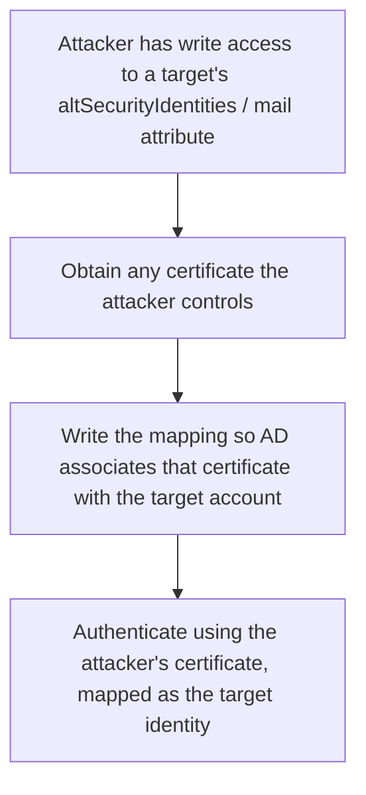
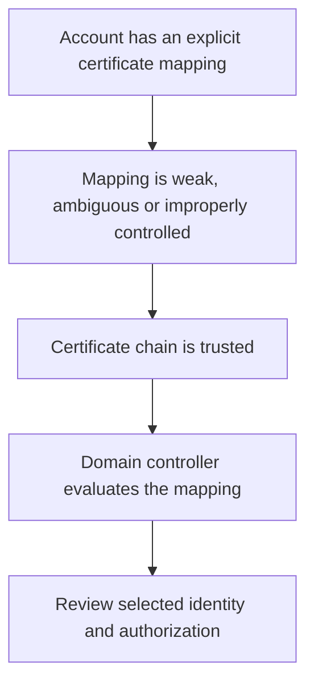

# AD CS ESC14: explicit certificate mapping

ESC14 covers risky explicit certificate-to-account mappings, commonly involving `altSecurityIdentities`. A mapping can be unsafe when it is weak, ambiguous, stale or writable by a principal that should not control identity bindings.

> **Authorized assessment only:** Review mapping values and ACLs with appropriate data handling. Do not create or alter mappings on production identities as proof.

## Beginner-friendly walkthrough

**In plain terms:** AD supports mapping a certificate to a specific user account explicitly, via
the `altSecurityIdentities` attribute, as an alternative to automatic mapping. ESC14 is what
happens when an attacker has write access to that attribute on a target account (or to the
account's `mail` attribute, in mapping modes that use it) — they can point the mapping at a
certificate they already control, making AD treat that certificate as proof of the target's
identity going forward.

**Objects abused / affected**

| Object | Normal purpose | What ESC14 touches |
| --- | --- | --- |
| `altSecurityIdentities` attribute | Explicitly maps a specific certificate to this account | Rewritten by an attacker with `GenericWrite`/`GenericAll` on the account |
| `mail` attribute (in some mapping modes) | Used as part of weaker mapping logic in certain configurations | Can be abused similarly where that mapping mode is in use |
| Attacker-controlled certificate | Any certificate the attacker can already obtain | Becomes an accepted credential for the victim account once mapped |



**Stages, and which tool typically covers each one**

1. **Find the write right** — the same way as any [ACL abuse](acl_abuse.md) finding; `BloodHound` is particularly suited to this one since it's graph/edge-based rather than template-based.
2. **Write the mapping** — `Certipy`'s account-update functionality supports modifying `altSecurityIdentities`/`mail` once the write right is confirmed.

Unlike most other ESCs, this one doesn't require abusing AD CS issuance policy at all — the certificate itself can be entirely unrelated to the victim; what's abused is purely the mapping attribute on the victim's own account object.

**Where exact command syntax lives:** this repo deliberately keeps technique pages
command-free (see `CONTRIBUTING.md`). For copy-pasteable enumeration/exploitation syntax for
this exact ESC, the authoritative public sources are the [Certipy Wiki](https://github.com/ly4k/Certipy/wiki)
(the tool that implements detection/abuse for ESC1–ESC17) and [HackTricks' AD CS domain escalation page](https://book.hacktricks.xyz/windows-hardening/active-directory-methodology/ad-certificates/domain-escalation).


## Conceptual path



## Conditions and limits

Impact depends on the mapping type and strength, who can write the attribute, certificate issuer and fields, domain-controller patch/configuration state, and relying-party behavior. An explicit mapping is not inherently unsafe.

## Affected object and fix

```text
Object: User or computer account
Setting to review: altSecurityIdentities value and the attribute's effective write permissions
Risky state: Weak, ambiguous, stale, or unauthorized certificate-to-account mapping
Fix target: Strong unique mapping per Microsoft guidance; restrict writes and remove stale entries
```

## Defensive review

Inventory explicit mappings and their owners. Prefer strong, uniquely bound mapping forms supported by current Microsoft guidance, remove stale entries, and restrict writes to trusted identity administrators.

## Detection

Audit writes to `altSecurityIdentities`, certificate mapping policy and privileged identity attributes. Correlate certificate-authentication events with the account selected, issuer, certificate fields and source host.

## References

- [AD CS ESC taxonomy overview](docs/techniques/adcs_esc_matrix.md)
- [Microsoft: KB5014754 certificate-based authentication changes](https://support.microsoft.com/kb/5014754)
- [MITRE ATT&CK: T1649](https://attack.mitre.org/techniques/T1649/)
