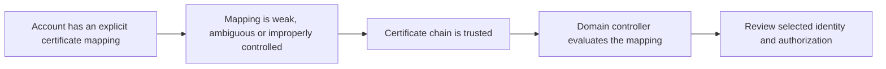

# AD CS ESC14: explicit certificate mapping

ESC14 covers risky explicit certificate-to-account mappings, commonly involving `altSecurityIdentities`. A mapping can be unsafe when it is weak, ambiguous, stale or writable by a principal that should not control identity bindings.

> **Authorized assessment only:** Review mapping values and ACLs with appropriate data handling. Do not create or alter mappings on production identities as proof.

## Conceptual path



## Conditions and limits

Impact depends on the mapping type and strength, who can write the attribute, certificate issuer and fields, domain-controller patch/configuration state, and relying-party behavior. An explicit mapping is not inherently unsafe.

## Affected object and fix

```text
Object: User or computer account
Setting to review: altSecurityIdentities value and the attribute's effective write permissions
Risky state: Weak, ambiguous, stale, or unauthorized certificate-to-account mapping
Fix target: Strong unique mapping per Microsoft guidance; restrict writes and remove stale entries
```

## Defensive review

Inventory explicit mappings and their owners. Prefer strong, uniquely bound mapping forms supported by current Microsoft guidance, remove stale entries, and restrict writes to trusted identity administrators.

## Detection

Audit writes to `altSecurityIdentities`, certificate mapping policy and privileged identity attributes. Correlate certificate-authentication events with the account selected, issuer, certificate fields and source host.

## References

- [AD CS ESC taxonomy overview](docs/techniques/adcs_esc_matrix.md)
- [Microsoft: KB5014754 certificate-based authentication changes](https://support.microsoft.com/kb/5014754)
- [MITRE ATT&CK: T1649](https://attack.mitre.org/techniques/T1649/)
