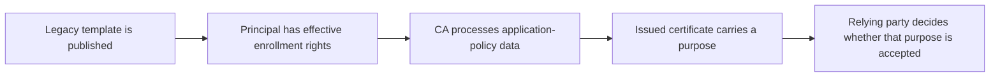

# AD CS ESC15: legacy template application policy

ESC15, sometimes described as “EKUwu,” concerns legacy schema-version-1 template behavior in which application-policy handling may allow a requester-controlled purpose to be included in an issued certificate. The exact outcome depends on CA behavior, template policy and relying-party interpretation.

> **Authorized assessment only:** Identify legacy templates and inspect issuance policy. Do not test arbitrary certificate purposes against production services.

## Conceptual path

## Conditions and limits

The template must be published and enrollable; CA and schema behavior must permit the relevant policy; and the relying party must trust the chain and accept the certificate purpose. A legacy template does not by itself prove a useful authentication path.

## Defensive review

Replace unneeded schema-version-1 templates with current templates, constrain application policies to the service requirement and restrict enrollment. Review issued certificates and applications that depend on legacy templates before retiring them.

## Detection

Inventory template schema and application-policy settings. Compare CA request/issuance records and issued certificate extensions with the approved template definition; correlate unusual purposes with authentication events.

## References

- [AD CS ESC taxonomy overview](docs/techniques/adcs_esc_matrix.md)
- [Microsoft: Certificate template concepts](https://learn.microsoft.com/windows-server/identity/ad-cs/certificate-template-concepts)
- [MITRE ATT&CK: T1649](https://attack.mitre.org/techniques/T1649/)
