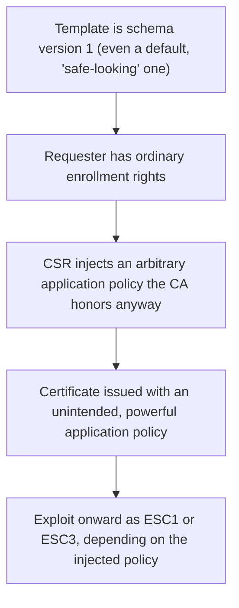
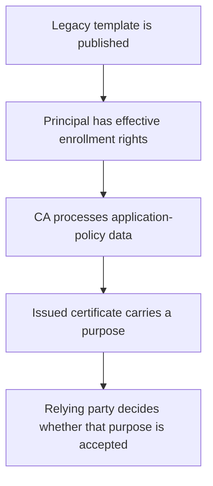

# AD CS ESC15: legacy template application policy

ESC15, sometimes described as “EKUwu,” concerns legacy schema-version-1 template behavior in which application-policy handling may allow a requester-controlled purpose to be included in an issued certificate. The exact outcome depends on CA behavior, template policy and relying-party interpretation.

> **Authorized assessment only:** Identify legacy templates and inspect issuance policy. Do not test arbitrary certificate purposes against production services.

## Beginner-friendly walkthrough

**In plain terms:** AD CS certificate templates come in schema "versions." Version 1 (V1)
templates predate the newer Application Policy enforcement that later schema versions added —
which means a V1 template can be tricked into issuing a certificate with an *arbitrary*
application policy the requester specifies in their request, even if the template itself never
defines that policy and doesn't have enrollee-supplied-subject enabled. This is sometimes
nicknamed "EKUwu." In practice it lets a requester turn an ordinary-looking V1 template (even a
default built-in one) into something that behaves like an enrollment-agent or client-auth
template on demand.

**Objects abused / affected**

| Object | Normal purpose | What ESC15 touches |
| --- | --- | --- |
| Schema version 1 certificate template | Legacy template format, predates modern application-policy enforcement | Allows the requester's CSR to inject an application policy the template itself never declared |
| Resulting certificate's application policy | Should reflect only what the template owner intended | Can end up carrying `Certificate Request Agent` or `Client Authentication`, enabling an ESC1/ESC3-style follow-on |



**Stages, and which tool typically covers each one**

1. **Find V1 templates** — `Certipy`'s enumeration mode flags schema-version-1 templates specifically, since the version number itself is the precondition, not any single flag.
2. **Exploit via policy injection** — `Certipy`'s request functionality supports supplying the application policy, which the V1 template's lack of enforcement then honors.

ESC15 is a relatively recent (2024) public disclosure, which is a useful reminder that AD CS misconfiguration research is still active — a template that passed an ESC1–ESC9 review a few years ago may still be exploitable under a technique that wasn't published yet at the time.

**Where exact command syntax lives:** this repo deliberately keeps technique pages
command-free (see `CONTRIBUTING.md`). For copy-pasteable enumeration/exploitation syntax for
this exact ESC, the authoritative public sources are the [Certipy Wiki](https://github.com/ly4k/Certipy/wiki)
(the tool that implements detection/abuse for ESC1–ESC17) and [HackTricks' AD CS domain escalation page](https://book.hacktricks.xyz/windows-hardening/active-directory-methodology/ad-certificates/domain-escalation).


## Conceptual path



## Conditions and limits

The template must be published and enrollable; CA and schema behavior must permit the relevant policy; and the relying party must trust the chain and accept the certificate purpose. A legacy template does not by itself prove a useful authentication path.

## Affected object and fix

```text
Object: AD CS certificate template and the CA processing it
Settings to review: Template schema version, application-policy behavior, patch state
Risky state: Affected legacy template behavior permits an unintended certificate purpose
Fix target: Apply vendor security updates; retire or replace affected legacy templates
```

## Defensive review

Replace unneeded schema-version-1 templates with current templates, constrain application policies to the service requirement and restrict enrollment. Review issued certificates and applications that depend on legacy templates before retiring them.

## Detection

Inventory template schema and application-policy settings. Compare CA request/issuance records and issued certificate extensions with the approved template definition; correlate unusual purposes with authentication events.

## References

- [AD CS ESC taxonomy overview](docs/techniques/adcs_esc_matrix.md)
- [Microsoft: Certificate template concepts](https://learn.microsoft.com/windows-server/identity/ad-cs/certificate-template-concepts)
- [MITRE ATT&CK: T1649](https://attack.mitre.org/techniques/T1649/)
