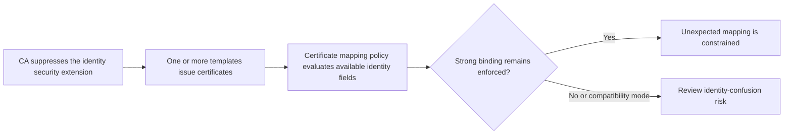

# AD CS ESC16: CA security-extension suppression

ESC16 describes CA configuration that suppresses the security extension used to bind certificates to directory identities. Unlike a template-specific setting, the CA-level behavior can affect multiple templates. The resulting risk depends on certificate contents and the relying party's mapping policy.

> **Authorized assessment only:** Inspect CA policy and issued-certificate metadata read-only. Do not alter extension policy on a production CA for testing.

## Conceptual path

## Conditions and limits

CA-wide suppression alone is not proof of account impersonation. Template identity fields, strong-binding enforcement, compatibility exceptions, certificate trust, patch state and relying-party behavior all affect the result.

## Defensive review

Keep the security extension enabled unless a documented compatibility requirement exists. Scope and time-limit exceptions, inventory every affected CA and template, and test dependent applications before remediation.

## Detection and recovery

Monitor CA configuration changes and compare issued certificate extensions against expected policy. Correlate issuance, certificate authentication and account mapping. If unexpected suppression is found, preserve evidence, restore approved CA settings and assess certificates issued during the affected window.

## References

- [AD CS ESC taxonomy overview](docs/techniques/adcs_esc_matrix.md)
- [Microsoft: KB5014754 certificate-based authentication changes](https://support.microsoft.com/kb/5014754)
- [MITRE ATT&CK: T1649](https://attack.mitre.org/techniques/T1649/)
