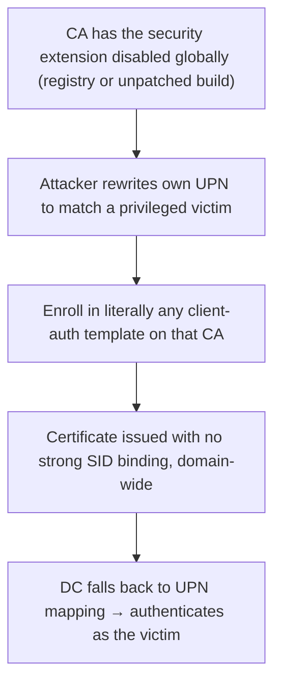
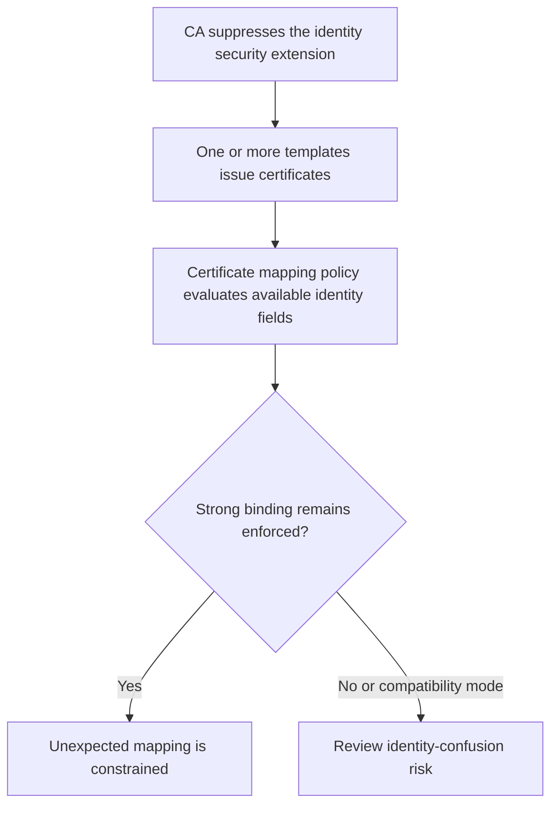

# AD CS ESC16: CA security-extension suppression

ESC16 describes CA configuration that suppresses the security extension used to bind certificates to directory identities. Unlike a template-specific setting, the CA-level behavior can affect multiple templates. The resulting risk depends on certificate contents and the relying party's mapping policy.

> **Authorized assessment only:** Inspect CA policy and issued-certificate metadata read-only. Do not alter extension policy on a production CA for testing.

## Beginner-friendly walkthrough

**In plain terms:** [ESC9](adcs_esc9.md) is one template configured to skip the strong SID
security extension. ESC16 is the same underlying weakness turned up to the whole CA: the
security extension is disabled globally, for every certificate the CA issues, via a CA-level
registry setting rather than a per-template flag — either because of that configuration, or
because the CA is missing the relevant 2022 security update entirely. The UPN-rewrite-and-enroll
trick from ESC9 then works against *any* template on that CA, not just one specifically
misconfigured one.

**Objects abused / affected**

| Object | Normal purpose | What ESC16 touches |
| --- | --- | --- |
| CA-wide security-extension setting | Should embed the strong SID-binding extension in every issued certificate | Disabled globally, via registry or an unpatched CA build |
| Every template on that CA | Each would normally need its own ESC9-style misconfiguration to be exploitable | All become exploitable the same way at once |
| Target account's UPN | Normally stable and unique | Rewritten by the attacker, exactly as in ESC9 |



**Stages, and which tool typically covers each one**

1. **Check CA-wide status** — `Certipy`'s CA-enumeration mode checks this setting directly, distinct from the per-template check used for ESC9.
2. **Exploit it** — identical mechanics to [ESC9](adcs_esc9.md); the only difference is scope (every template on the CA, rather than one).
3. **Why ESC16 can combine with ESC6** — if `EDITF_ATTRIBUTESUBJECTALTNAME2` ([ESC6](adcs_esc6.md)) is *also* set, the two together can bypass even stricter environment-level SID-validation safeguards.

Confirming current patch level and the CA-wide security-extension registry state are both quick, high-value checks precisely because this one weakness invalidates the "but only that one template was misconfigured" assumption.

**Where exact command syntax lives:** this repo deliberately keeps technique pages
command-free (see `CONTRIBUTING.md`). For copy-pasteable enumeration/exploitation syntax for
this exact ESC, the authoritative public sources are the [Certipy Wiki](https://github.com/ly4k/Certipy/wiki)
(the tool that implements detection/abuse for ESC1–ESC17) and [HackTricks' AD CS domain escalation page](https://book.hacktricks.xyz/windows-hardening/active-directory-methodology/ad-certificates/domain-escalation).


## Conceptual path



## Conditions and limits

CA-wide suppression alone is not proof of account impersonation. Template identity fields, strong-binding enforcement, compatibility exceptions, certificate trust, patch state and relying-party behavior all affect the result.

## Affected object and fix

```text
Object: Enterprise CA configuration
Setting to review: Extension-suppression policy, including the NTDS security extension
Risky state: CA omits the identity-binding extension without an approved compatibility need
Fix target: Stop suppressing the extension; review affected templates and certificates
```

## Defensive review

Keep the security extension enabled unless a documented compatibility requirement exists. Scope and time-limit exceptions, inventory every affected CA and template, and test dependent applications before remediation.

## Detection and recovery

Monitor CA configuration changes and compare issued certificate extensions against expected policy. Correlate issuance, certificate authentication and account mapping. If unexpected suppression is found, preserve evidence, restore approved CA settings and assess certificates issued during the affected window.

## References

- [AD CS ESC taxonomy overview](docs/techniques/adcs_esc_matrix.md)
- [Microsoft: KB5014754 certificate-based authentication changes](https://support.microsoft.com/kb/5014754)
- [MITRE ATT&CK: T1649](https://attack.mitre.org/techniques/T1649/)
