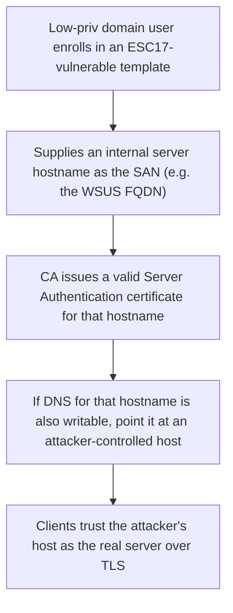

# AD CS ESC17: Server Authentication + enrollee-supplied SAN

ESC17 is a 2026 addition to the ESC taxonomy, proposed by the Digitrace team and merged into
Certipy mid-2026. It describes a certificate template that combines the **Server
Authentication** EKU with **enrollee-supplied-subject** rights — the mirror image of ESC1
(which pairs enrollee-supplied-subject with *Client* Authentication). Where ESC1 lets an
attacker impersonate a user or computer identity, ESC17 lets an attacker obtain a
server-identity certificate (valid TLS server auth) for any internal hostname they choose, with
no administrative rights required.

> **Authorized assessment only:** This guide describes controlled, explicitly authorized
> assessment and defensive validation. It contains no target commands, exploit recipes, payloads
> or real-target procedure.

## Beginner-friendly walkthrough

**In plain terms:** a certificate with Server Authentication EKU is what lets a service prove
"you really are talking to `server.corp.local`" over TLS. If a template lets the *requester*
choose which hostname that certificate is for, a low-privileged domain user can mint a
legitimate, CA-signed TLS certificate for a server they don't own — for example, an internal
software-update server (WSUS). Combined with the ability to point a client at a
different IP for that hostname (for instance via DNS write access), this can make a client
machine trust an attacker-controlled host as if it were the real update server, which is a
direct route to pushing attacker-chosen "updates."

**Objects abused / affected**

| Object | Normal purpose | What ESC17 touches |
| --- | --- | --- |
| Certificate template | Should restrict Server Authentication certs to the actual server's own enrollment | Combines Server Auth EKU with enrollee-supplied-subject, letting any enrollee choose the hostname |
| DNS zone object (if also writable) | Resolves hostnames to IPs | A separate write right here lets the attacker redirect the chosen hostname to a host they control |
| Relying client (e.g. a WSUS client) | Trusts TLS certificates signed by the internal CA for its configured server hostname | Accepts the attacker's certificate as proof it is talking to the real server |

**Stages, and which tool typically covers each one**

1. **Find vulnerable templates** — `Certipy`'s enumeration mode (v5.0.2+) flags ESC17 directly, the same way it flags ESC1, by checking for the Server Authentication EKU alongside enrollee-supplied-subject rights.
2. **Request the certificate** — the same enrollment mechanism as any other ESC in this family; no special agent role or CA-level right is needed.
3. **Chain onward (if applicable)** — pairing this with write access to the relevant DNS zone object is what turns "I can mint a certificate" into "I can impersonate a specific internal server end-to-end"; this second half of the chain is a separate, independently-checkable finding.

## Prerequisite chain

The template must be published and enrollable by the assessed principal, must carry the Server
Authentication EKU, and must allow enrollee-supplied-subject. A full impersonation chain
additionally requires some way to redirect clients to the attacker's host for the chosen
hostname (DNS write access being the most direct, but not the only, route).

## Impact limits and failure cases

Obtaining the certificate alone does not redirect any traffic — it is a necessary but not
sufficient condition. Network segmentation, DNS-zone ACL hygiene, and client-side pinning or
additional validation (where configured) can all independently block the second half of the
chain even when the template itself is vulnerable.

## Detection and validation

Monitor certificate issuance events (4886/4887) for Server Authentication templates where the
SAN does not match the requesting principal's own computer identity — this is the direct
analog of monitoring ESC1 issuance for mismatched client identities. Correlate with DNS zone
change events if a redirection step is suspected.

## Mitigation and recovery

**Mitigation:** Remove enrollee-supplied-subject from any template carrying the Server
Authentication EKU; restrict enrollment on Server Authentication templates to the specific
service accounts/computers that legitimately need them.

**Recovery:** Preserve evidence, revoke any improperly issued certificates, correct the template
configuration, and review DNS zone ACLs for related write-access exposure.

## References

- [AD CS ESC taxonomy overview](adcs_esc_matrix.md)
- [ESC17 write-up: the WSUS/DNS abuse chain](https://mustafanafizdurukan.github.io/posts/esc17-wsus-dns-abuse)
- [Certipy pull request proposing ESC17](https://github.com/ly4k/Certipy/pull/344)
- [Microsoft: Certificate template concepts](https://learn.microsoft.com/windows-server/identity/ad-cs/certificate-template-concepts)
- [MITRE ATT&CK: T1649](https://attack.mitre.org/techniques/T1649/)
