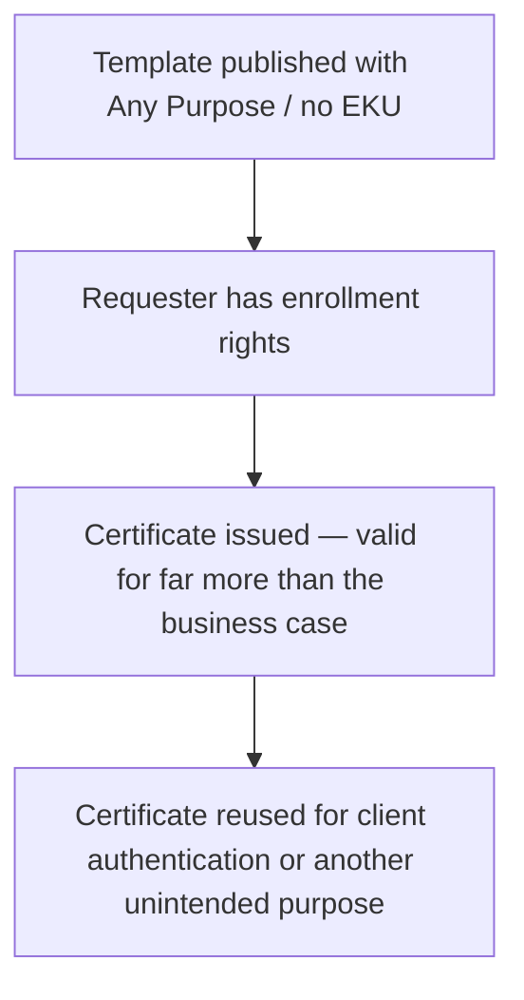
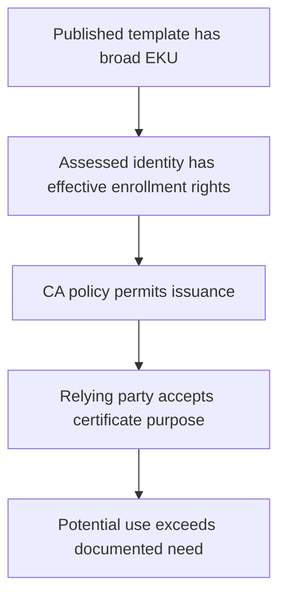

# AD CS ESC2: broad certificate purpose

ESC2 describes a published certificate template whose Extended Key Usage (EKU) is `Any Purpose` or absent. That broad purpose can make an issued certificate acceptable for more uses than the template's business purpose intended. It does not by itself establish identity impersonation or privilege.

> **Authorized assessment only:** Review template and CA configuration read-only. Validate certificate use only in an explicitly authorized lab.

## Beginner-friendly walkthrough

**In plain terms:** a certificate's Extended Key Usage (EKU) is supposed to say "this certificate
may only be used for X" (e.g. only for signing email, or only for logging in). ESC2 is a
template that was published with EKU set to `Any Purpose`, or left blank — meaning the resulting
certificate can be used for anything a certificate can be used for, including the kind of
authentication abuse seen in [ESC1](adcs_esc1.md), even though the template's business purpose
never required that.

**Objects abused / affected**

| Object | Normal purpose | What ESC2 touches |
| --- | --- | --- |
| Certificate template | Scopes what an issued certificate may be used for | Published with `Any Purpose` EKU or none at all, instead of the narrow purpose the service actually needs |
| Enrollment rights | Control who may request a certificate from the template | If broadly delegated (e.g. Domain Users), a wide population can obtain the over-permissioned certificate |
| Issued certificate | Normally represents one narrow use case | Can be reused for client authentication or other purposes the template owner never intended |



**Stages, and which tool typically covers each one**

1. **Find the template** — `Certipy`'s template-enumeration mode and `Certify` both read `pKIExtendedKeyUsage`/`msPKI-Certificate-Application-Policy` via LDAP and flag any template with a missing or `Any Purpose` EKU.
2. **Confirm it's reachable** — the same tools cross-reference enrollment rights so you know whether the broad-EKU template is also broadly enrollable (the combination is what makes it exploitable, not the EKU alone).
3. **Why this often chains into ESC1** — a broad-EKU template combined with enrollee-supplied-subject rights is effectively ESC1 with extra steps; review both conditions together.

**Where exact command syntax lives:** this repo deliberately keeps technique pages
command-free (see `CONTRIBUTING.md`). For copy-pasteable enumeration/exploitation syntax for
this exact ESC, the authoritative public sources are the [Certipy Wiki](https://github.com/ly4k/Certipy/wiki)
(the tool that implements detection/abuse for ESC1–ESC17), [HackTricks' AD CS domain escalation page](https://book.hacktricks.xyz/windows-hardening/active-directory-methodology/ad-certificates/domain-escalation),
and the original [SpecterOps "Certified Pre-Owned" paper](https://specterops.io/wp-content/uploads/sites/3/2022/06/Certified_Pre-Owned.pdf).


## Conceptual path



## Conditions and limits

The template must be published and enrollable by the assessed principal. CA approval, authorized signatures, chain trust, key usage and relying-party policy can constrain acceptance. A broad EKU is a risk indicator, not proof that a certificate can authenticate as another identity.

## Affected object and fix

```text
Object: pKICertificateTemplate
Setting to review: pKIExtendedKeyUsage and msPKI-Certificate-Application-Policy
Risky state: Any Purpose or no EKU where the business requirement is narrower
Fix target: Only the required application purpose; enrollment limited to its owner group
```

## Defensive review

Replace broad or absent EKUs with the narrow application policy required by the service. Remove unused templates, restrict enrollment and template modification, and test dependent services in a lab before changing issuance policy.

## Detection

Baseline each template's intended EKU and enrollment population. Investigate CA issuance events 4886/4887 when the template, requester, purpose or relying-party use differs from the approved workflow; correlate with certificate authentication and directory changes.

## References

- [AD CS ESC taxonomy overview](docs/techniques/adcs_esc_matrix.md)
- [Microsoft: Certificate template concepts](https://learn.microsoft.com/windows-server/identity/ad-cs/certificate-template-concepts)
- [MITRE ATT&CK: T1649](https://attack.mitre.org/techniques/T1649/)
