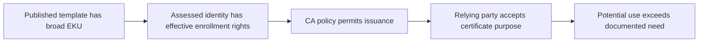

# AD CS ESC2: broad certificate purpose

ESC2 describes a published certificate template whose Extended Key Usage (EKU) is `Any Purpose` or absent. That broad purpose can make an issued certificate acceptable for more uses than the template's business purpose intended. It does not by itself establish identity impersonation or privilege.

> **Authorized assessment only:** Review template and CA configuration read-only. Validate certificate use only in an explicitly authorized lab.

## Conceptual path

## Conditions and limits

The template must be published and enrollable by the assessed principal. CA approval, authorized signatures, chain trust, key usage and relying-party policy can constrain acceptance. A broad EKU is a risk indicator, not proof that a certificate can authenticate as another identity.

## Defensive review

Replace broad or absent EKUs with the narrow application policy required by the service. Remove unused templates, restrict enrollment and template modification, and test dependent services in a lab before changing issuance policy.

## Detection

Baseline each template's intended EKU and enrollment population. Investigate CA issuance events 4886/4887 when the template, requester, purpose or relying-party use differs from the approved workflow; correlate with certificate authentication and directory changes.

## References

- [AD CS ESC taxonomy overview](docs/techniques/adcs_esc_matrix.md)
- [Microsoft: Certificate template concepts](https://learn.microsoft.com/windows-server/identity/ad-cs/certificate-template-concepts)
- [MITRE ATT&CK: T1649](https://attack.mitre.org/techniques/T1649/)
